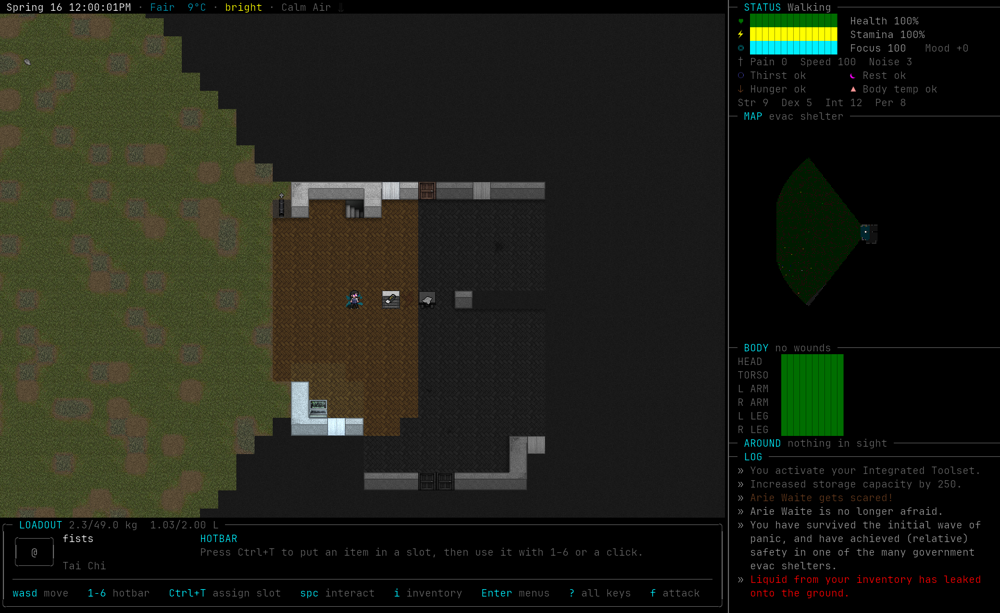
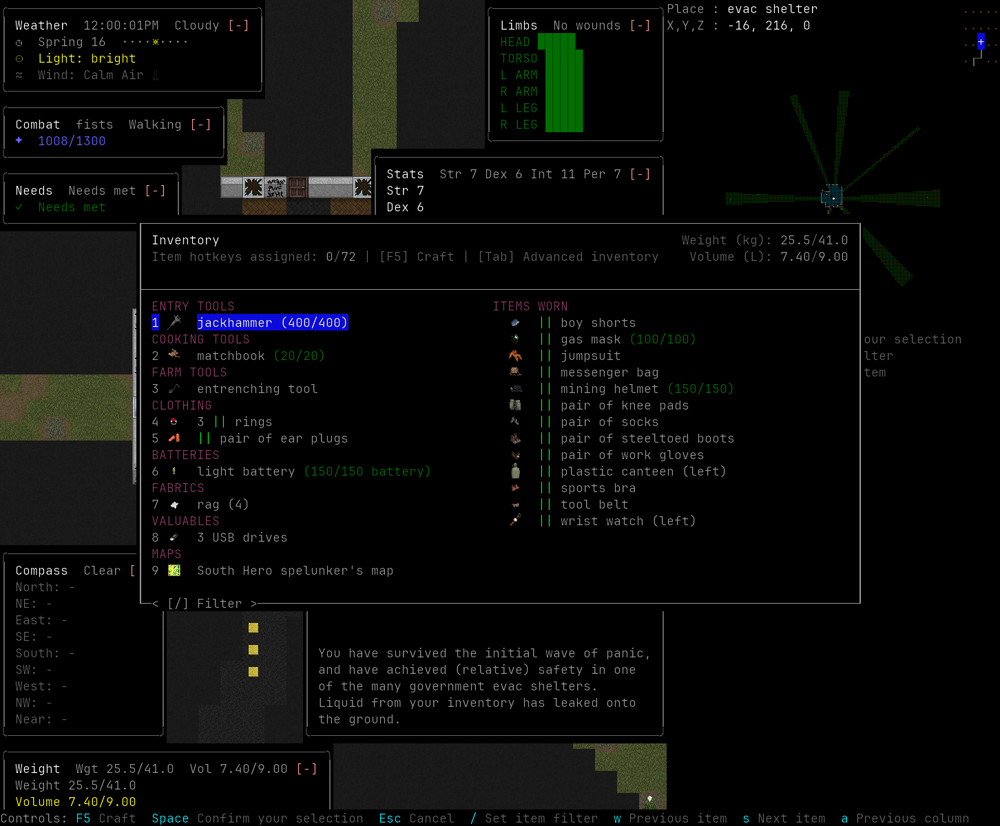
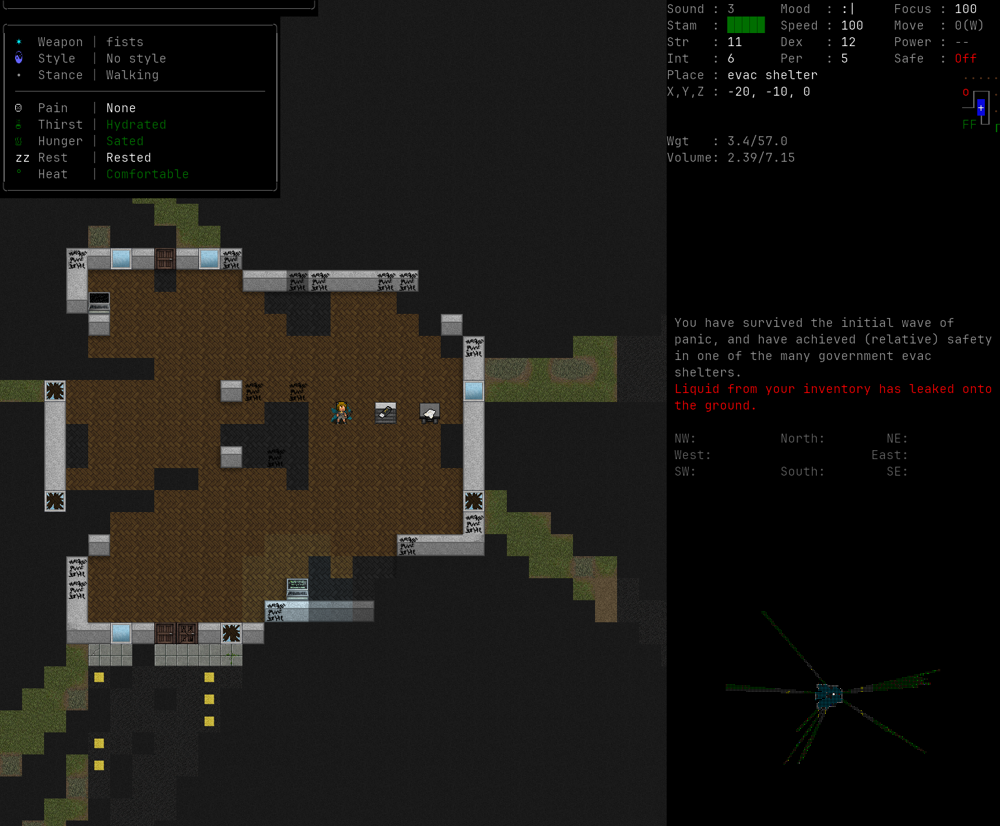
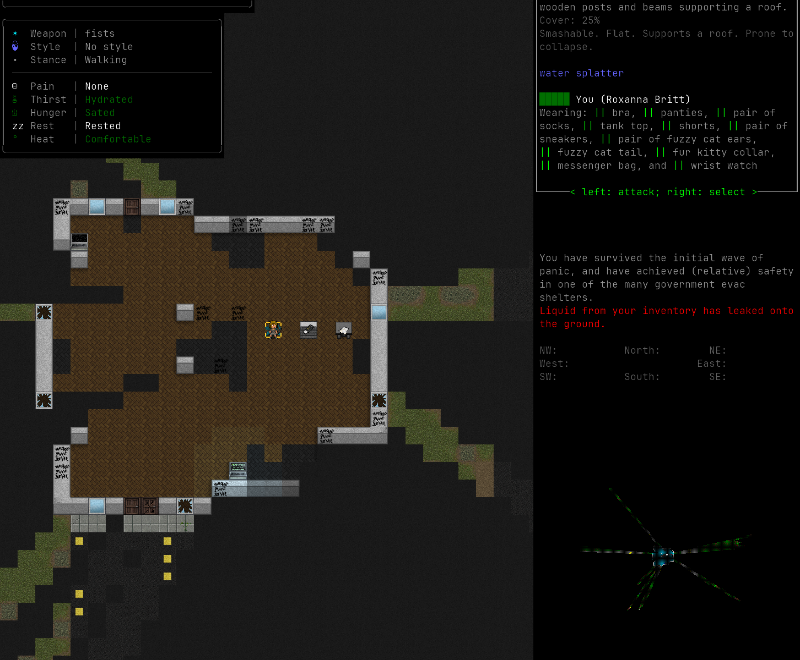
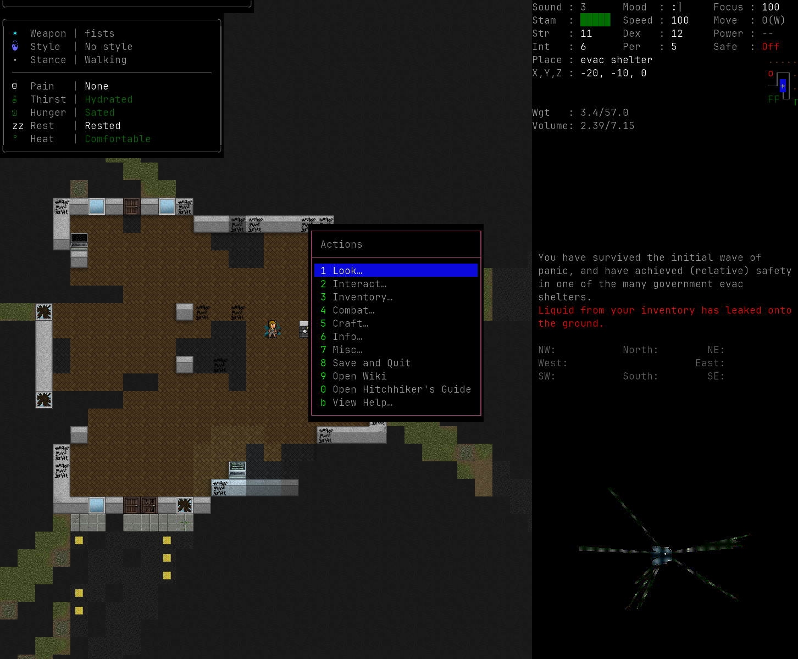

# Bright Nights Overhaul

> **Work in progress.** Bright Nights Overhaul is a fork of
> [Cataclysm: Bright Nights](https://github.com/cataclysmbn/Cataclysm-BN) that aims to make the
> game more accessible and intuitive for players. It keeps Bright Nights' world, items, monsters
> and rules, and reworks the controls, the interface and the busywork around them. Expect rough
> edges: features change between releases, and feedback shapes what comes next.

<header align="center">
  
</header>

Cataclysm: Bright Nights is a roguelike with sci-fi elements set in a post-apocalyptic world.

While some have described it as a "zombie game", there is far more to Cataclysm than that. Struggle
to survive in a harsh, persistent, procedurally generated world. Scavenge the remnants of a dead
civilization for food, equipment, or, if you are lucky, a vehicle with a full tank of gas to get you
the hell out of there.

Fight to defeat or escape from a wide variety of powerful monstrosities, from zombies to giant
insects to killer robots and things far stranger and deadlier, and against the others like yourself,
who want what you have.

Find a way to stop the Cataclysm ... or become one of its strongest monsters.

## What the overhaul changes

- **Modern controls.** WASD walks (Q E Z C for diagonals) and walking into an enemy attacks it.
  Space does the obvious thing with the tile beside you: opens a door, talks, picks up, uses stairs.
  Enter holds every other action, `i` opens items with their actions, and `?` lists every key on
  every screen. The original keys remain one option away (Options → Interface → Control scheme →
  Classic).
- **Mouse support.** Hover a tile to see what is there, right click to select it without spending
  time, left click to use what is beside you. Menus, inventory, crafting, trade, the overmap and the
  hotbar respond to clicks and the wheel. In Modern, a click never moves your character.
- **A readable interface.** The fusion HUD puts health, needs, loadout, surroundings and a coloured
  log on one screen, with a hotbar for six items. Smaller screens get a grouped sidebar. A welcome
  card and first tips explain the basics.
- **Less busywork.** Quick stack puts carried items into nearby storage that already holds them.
  Related items (batteries, rings, novels and the like) fold into one line with a count. Pickup,
  sorting and crafting need fewer steps.
- **Upstream bug fixes** that the fork found while playtesting.

[The controls guide](./docs/fork/controls.md) maps every key, [OVERHAUL.md](./OVERHAUL.md)
explains every change, [the screenshots](./docs/fork/feature-screenshots.md) show them, and
[the changelog](./CHANGELOG-OVERHAUL.md) lists them by date.

|                    Inventory                     |                    Crafting                     |
| :----------------------------------------------: | :---------------------------------------------: |
|      |      |
|           Look around and tile selection          |                 The Enter menu                  |
|           |    |

> Cataclysm: Bright Nights is itself a fork of Cataclysm: Dark Days Ahead.
> [See how Bright Nights differs from its ancestor](https://docs.cataclysmbn.org/game/changelog/).

## Downloads

Download this fork from [Bright Nights Overhaul releases][fork-releases].

| Platform       | File                                    |
| -------------- | --------------------------------------- |
| Windows 64-bit | `BrightNightsOverhaul-windows-x64.zip`  |
| Linux 64-bit   | `BrightNightsOverhaul-linux-x64.tar.gz` |

On Windows, extract the zip and run `Launch Bright Nights.bat`. It offers new versions and keeps
your saves and settings. See the [installation and update guide](docs/fork/playing.md).
Maintainers use the [release guide](docs/fork/releasing.md).

Upstream Bright Nights releases, Flatpak packages and third-party launchers do not contain this
fork's changes. The fork keeps its own saves and settings, so it can sit next to an upstream
install.

### Third Party Mods

Bright Nights mods work here too. The [Bright Nights mod registry](https://mods.cataclysmbn.org/)
lists mods that are not shipped with the game.

### Source Code

[![Source Code][source-badge]][source] [![Zip Archive][clone-badge]][clone]

[fork-releases]: https://github.com/Kenja-mc/Cataclysm-BN/releases/latest
[source]: https://github.com/Kenja-mc/Cataclysm-BN/archive/refs/heads/main.zip "Download this fork's source"
[source-badge]: https://img.shields.io/badge/Zip%20Archive-black?style=for-the-badge&logo=github
[clone]: https://github.com/Kenja-mc/Cataclysm-BN/ "Clone this fork"
[clone-badge]: https://img.shields.io/badge/Clone%20From%20Repo-black?style=for-the-badge&logo=github

#### Building from source

On Linux, the [installation guide](docs/fork/playing.md#building-from-source-on-linux) builds the
terminal and tiles versions and installs `bno` / `bno-tiles` launchers. The upstream guides cover
other platforms:

- [building with cmake](docs/en/dev/guides/building/cmake.md)
- [building with MSYS2](docs/en/dev/guides/building/msys.md)
- [building with vcpkg](docs/en/dev/guides/building/vs_vcpkg.md)

## Contributing

> Cataclysm: Bright Nights developed under Creative Commons Attribution ShareAlike 3.0 license. The
> code and content of the game is free to use, modify, and redistribute for any purpose whatsoever.
> See http://creativecommons.org/licenses/by-sa/3.0/ for details. Some code distributed with the
> project is not part of the project and is released under different software licenses, the files
> covered by different software licenses have their own license notices.

Issues and pull requests for the overhaul go to
[this fork](https://github.com/Kenja-mc/Cataclysm-BN/issues), not to upstream Bright Nights.
[AGENTS.md](./AGENTS.md) lists the fork's rules: no balance changes without the owner's approval,
new behaviour behind an option when the old one can still be wanted, and an end-to-end test for
each feature. The upstream [contributing docs](https://docs.cataclysmbn.org/contribute/contributing/)
cover the code style.

## Documentation

- [OVERHAUL.md](./OVERHAUL.md): every fork change, how to use it and how to switch it off.
- [Controls guide](docs/fork/controls.md): keyboards and key tables for Modern and Classic.
- [Installation and feedback guide](docs/fork/playing.md).
- [Fork screenshots](docs/fork/feature-screenshots.md) and [visual changes](docs/fork/visual-changes.md).
- [Asset credits and licenses](docs/fork/asset-credits.md).

Gameplay and development documentation for Bright Nights itself is in the [docs](./docs/) directory
in markdown format. You can also

- visit the [official Bright Nights docs](https://docs.cataclysmbn.org/) site
- [build and serve the documentation locally](./docs/en/contribute/docs.md)

## Community

Fork-specific questions and reports belong on
[this fork's issue tracker](https://github.com/Kenja-mc/Cataclysm-BN/issues). The Bright Nights
community covers the game itself:

[][docs]
[][discussion]
[][discord]
[][modding]

[discussion]: https://github.com/cataclysmbn/Cataclysm-BN/discussions
[discord]: https://discord.gg/XW7XhXuZ89
[modding]: https://discord.gg/B5q4XCa "Unofficial DDA modding community discord has a BN channel"
[docs]: https://docs.cataclysmbn.org "Official BN documentation"

## Frequently Asked Questions

#### Is there a tutorial?

Your first new game opens with a welcome card listing the main keys, and first tips appear as you
play (Options → Interface → Show welcome card brings the card back). The tutorial in the
**Special** menu on the title screen teaches the Modern keys when Modern is selected. Press `?`
anywhere to see that screen's keys.

#### How can I change the key bindings?

Press `?` to list the keys of the current screen. Press `+` there to add a key binding, choose the
action with its letter, and then press the key you want. Options → Interface → Control scheme
switches between Modern (WASD) and Classic; your own key changes are kept either way.

#### How can I start a new world?

**World** on the main menu will generate a fresh world for you. Select **Create World**.

#### There is no music (or sound) in the game. How can I add it?

The release ships sound effects but no music, because the recommended
[Otopack](https://github.com/NarandBD/Otopack-BN-Mk-2) soundpack does not allow redistribution.
The [installation guide](docs/fork/playing.md#music) explains where to unpack it; then choose it
under **Options → General → Choose soundpack** and restart. **Enter → Misc → Sound & volume**
sets the volumes. The terminal version has no audio.

#### Where should I put 3rd-party mods?

First boot up the game, select **Help**, and choose **Resolved game directories**. Place mods in
the folder after "user mods: ".

Otherwise:

- Windows: the `mods` folder inside the game folder (next to the `.exe`). Updates keep your own mods.
- Linux release: `~/.cataclysm-bn/mods`.
- Linux, installed with `bin/install-bno.sh`: `~/.local/share/bright-nights-overhaul/mods`.

#### How do I update the game?

On Windows, `Launch Bright Nights.bat` offers each new release and keeps your saves, settings,
mods, tilesets and soundpacks. On Linux, delete the old `BrightNightsOverhaul` folder (your saves
are not in it) and unpack the new release in its place. The
[installation guide](docs/fork/playing.md) has the details.

#### I've found a bug. What should I do?

[Open a bug report on this fork](https://github.com/Kenja-mc/Cataclysm-BN/issues/new?template=bug_report.yml)
and attach `debug.log` ([where to find it](docs/fork/playing.md#the-game-log)). Report a bug to
upstream Bright Nights only when it also happens in an upstream release.

In game, **Escape → Debug Menu → Info → Submit a bug report on github** opens the same form with
the version and configuration filled in.

#### I would like to make a suggestion. What should I do?

[Open an issue on this fork](https://github.com/Kenja-mc/Cataclysm-BN/issues/new?template=feature_request.yml).
Ideas that make the game easier to learn or use, without changing its balance, fit the overhaul
best.

## Credits

- **Cataclysm** was created by Whales; TheDarklingWolf and GlyphGryph started Dark Days Ahead.
- **Cataclysm: Dark Days Ahead** is developed by CleverRaven and its contributors, including
  Kevin Granade.
- **Cataclysm: Bright Nights** is developed by the
  [Bright Nights contributors](https://github.com/cataclysmbn/Cataclysm-BN/graphs/contributors);
  nearly all of this game is their work. The in-game credits list them in full.
- **Bright Nights Overhaul** is maintained by [Kenja-mc](https://github.com/Kenja-mc).
- The tilesets, fonts, sounds and mod artwork come from many artists; see
  [asset credits](docs/fork/asset-credits.md). The default tileset is MSX++ UnDeadPeople Edition by
  SomeDeadGuy and its contributors.
- Design ideas were borrowed from Sword of the Stars: The Pit (mouse tile selection), Terraria
  (quick stack), Project Zomboid (body panel) and Caves of Qud (onboarding).
