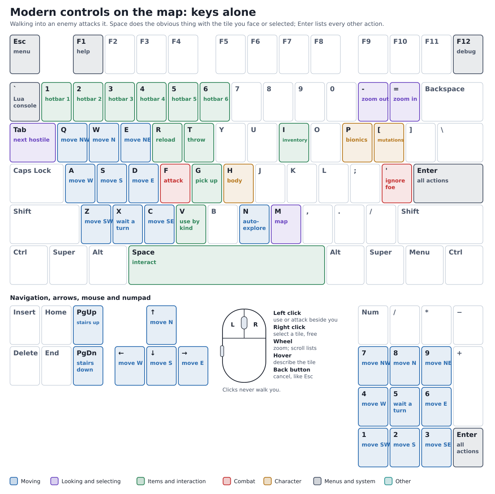
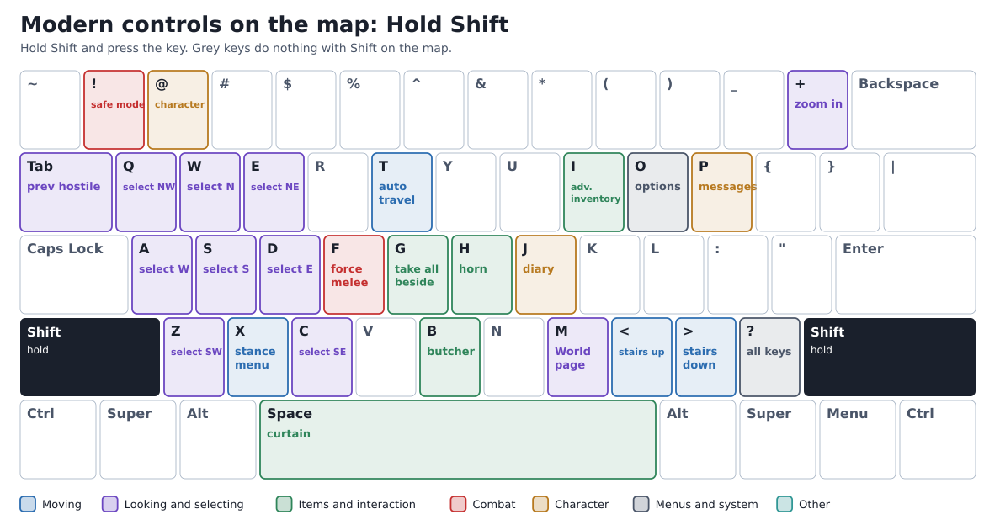
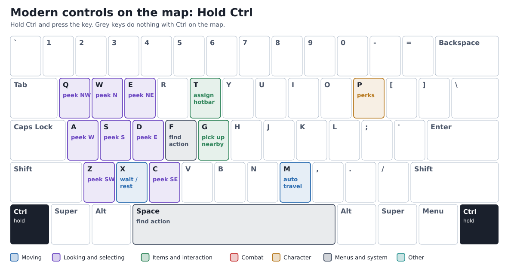

# Controls guide

Bright Nights Overhaul starts in the **Modern** control scheme: WASD to walk, Space to interact,
Enter for every other action and the mouse to look and select. **Classic** keeps upstream Bright
Nights' keys; switch under **Options → Interface → Control scheme**. Keys you rebind yourself are
kept in either scheme.

Letters are shown as printed on the keycap; <kbd>Shift</kbd>+ means hold Shift.
Press <kbd>?</kbd> on any screen to list that screen's keys. In that list, <kbd>+</kbd> adds a
key to the highlighted action and <kbd>-</kbd> removes one.

The tables and the keyboard are generated from the binding files by
`python3 build-scripts/gen_controls_guide.py`; edit the text outside the generated blocks by hand.

## Three keys to remember

| Key | What it does |
| --- | --- |
| <kbd>Space</kbd> | The obvious action for the tile you face or selected: opens or closes a door, talks to a neighbouring NPC, picks up a pile, uses stairs, loots a vehicle trunk, butchers a corpse, vaults a low obstacle, examines, then smashes. A menu appears only when two actions tie or one is destructive. |
| <kbd>Enter</kbd> | Every action, grouped: items, interaction, information, crafting, vehicles, settings. |
| <kbd>I</kbd> | Your items. Choose one to wield, wear, eat, use, read or drop it. <kbd>F5</kbd> in the inventory opens crafting. |

## On the map

Walking into an enemy attacks it. The numpad also walks, and the arrow keys move the aiming
reticle. Top-row <kbd>1</kbd>–<kbd>6</kbd> use the hotbar slots, never move you.

<!-- BEGIN generated:map -->

### Moving

| Action | Modern | Classic |
| --- | --- | --- |
| Move north | <kbd>W</kbd>, <kbd>↑</kbd>, <kbd>Numpad 8</kbd> | <kbd>K</kbd>, <kbd>8</kbd>, <kbd>↑</kbd>, <kbd>Numpad 8</kbd> |
| Move west | <kbd>A</kbd>, <kbd>←</kbd>, <kbd>Numpad 4</kbd> | <kbd>H</kbd>, <kbd>←</kbd>, <kbd>4</kbd>, <kbd>Numpad 4</kbd> |
| Move south | <kbd>S</kbd>, <kbd>↓</kbd>, <kbd>Numpad 2</kbd> | <kbd>J</kbd>, <kbd>↓</kbd>, <kbd>2</kbd>, <kbd>Numpad 2</kbd> |
| Move east | <kbd>D</kbd>, <kbd>→</kbd>, <kbd>Numpad 6</kbd> | <kbd>L</kbd>, <kbd>→</kbd>, <kbd>6</kbd>, <kbd>Numpad 6</kbd> |
| Move northwest | <kbd>Q</kbd>, <kbd>Numpad 7</kbd> | <kbd>Y</kbd>, <kbd>7</kbd>, <kbd>Numpad 7</kbd> |
| Move northeast | <kbd>E</kbd>, <kbd>Numpad 9</kbd> | <kbd>U</kbd>, <kbd>9</kbd>, <kbd>Numpad 9</kbd> |
| Move southwest | <kbd>Z</kbd>, <kbd>Numpad 1</kbd> | <kbd>B</kbd>, <kbd>1</kbd>, <kbd>Numpad 1</kbd> |
| Move southeast | <kbd>C</kbd>, <kbd>Numpad 3</kbd> | <kbd>N</kbd>, <kbd>3</kbd>, <kbd>Numpad 3</kbd> |
| Pause | <kbd>X</kbd>, <kbd>Numpad 5</kbd> | <kbd>.</kbd>, <kbd>5</kbd>, <kbd>Numpad 5</kbd> |
| Wait for Several Minutes | <kbd>Ctrl</kbd>+<kbd>X</kbd> | <kbd>&#124;</kbd> |
| Movement Mode Menu | <kbd>Shift</kbd>+<kbd>X</kbd> | <kbd>"</kbd> |
| Ascend stairs | <kbd>PgUp</kbd>, <kbd><</kbd> | <kbd>PgUp</kbd>, <kbd><</kbd> |
| Descend stairs | <kbd>PgDn</kbd>, <kbd>></kbd> | <kbd>PgDn</kbd>, <kbd>></kbd> |
| Explore the nearest unexplored area | <kbd>N</kbd> | — |
| Toggle Auto Travel Mode | <kbd>Shift</kbd>+<kbd>T</kbd>, <kbd>Ctrl</kbd>+<kbd>M</kbd> | <kbd>Ctrl</kbd>+<kbd>M</kbd> |

### Looking and selecting

| Action | Modern | Classic |
| --- | --- | --- |
| Select tile north | <kbd>Shift</kbd>+<kbd>W</kbd> | <kbd>Shift</kbd>+<kbd>K</kbd> |
| Select tile west | <kbd>Shift</kbd>+<kbd>A</kbd> | <kbd>Shift</kbd>+<kbd>H</kbd> |
| Select tile south | <kbd>Shift</kbd>+<kbd>S</kbd> | <kbd>Shift</kbd>+<kbd>J</kbd> |
| Select tile east | <kbd>Shift</kbd>+<kbd>D</kbd> | <kbd>Shift</kbd>+<kbd>L</kbd> |
| Select tile northwest | <kbd>Shift</kbd>+<kbd>Q</kbd> | — |
| Select tile northeast | <kbd>Shift</kbd>+<kbd>E</kbd> | — |
| Select tile southwest | <kbd>Shift</kbd>+<kbd>Z</kbd> | — |
| Select tile southeast | <kbd>Shift</kbd>+<kbd>C</kbd> | — |
| Peek north | <kbd>Ctrl</kbd>+<kbd>W</kbd> | — |
| Peek west | <kbd>Ctrl</kbd>+<kbd>A</kbd> | — |
| Peek south | <kbd>Ctrl</kbd>+<kbd>S</kbd> | — |
| Peek east | <kbd>Ctrl</kbd>+<kbd>D</kbd> | — |
| Peek northwest | <kbd>Ctrl</kbd>+<kbd>Q</kbd> | — |
| Peek northeast | <kbd>Ctrl</kbd>+<kbd>E</kbd> | — |
| Peek southwest | <kbd>Ctrl</kbd>+<kbd>Z</kbd> | — |
| Peek southeast | <kbd>Ctrl</kbd>+<kbd>C</kbd> | — |
| Next combat target | <kbd>Tab</kbd> | — |
| Previous combat target | <kbd>Shift</kbd>+<kbd>Tab</kbd> | — |
| Zoom in | <kbd>=</kbd>, <kbd>+</kbd>, <kbd>Wheel up</kbd> | <kbd>Z</kbd> |
| Zoom out | <kbd>-</kbd>, <kbd>Wheel down</kbd> | <kbd>Shift</kbd>+<kbd>Z</kbd> |
| View Map | <kbd>M</kbd> | <kbd>M</kbd> |
| World | <kbd>Shift</kbd>+<kbd>M</kbd> | — |

### Items and interaction

| Action | Modern | Classic |
| --- | --- | --- |
| Examine Nearby Terrain | <kbd>Space</kbd> | <kbd>E</kbd> |
| Toggle Vehicle Curtain | <kbd>Shift</kbd>+<kbd>Space</kbd> | — |
| Open Inventory | <kbd>I</kbd> | <kbd>I</kbd> |
| Advanced Inventory management | <kbd>Shift</kbd>+<kbd>I</kbd> | <kbd>/</kbd> |
| Use Item (by kind) | <kbd>V</kbd> | — |
| Pick up items from one nearby tile | <kbd>G</kbd> | <kbd>G</kbd> |
| Take everything beside you | <kbd>Shift</kbd>+<kbd>G</kbd> | — |
| Pick up items from all nearby tiles | <kbd>Ctrl</kbd>+<kbd>G</kbd> | <kbd>,</kbd> |
| Reload Item | <kbd>R</kbd> | <kbd>R</kbd> |
| Throw Item | <kbd>T</kbd> | <kbd>T</kbd> |
| Butcher | <kbd>Shift</kbd>+<kbd>B</kbd> | <kbd>Shift</kbd>+<kbd>B</kbd> |
| Honk the horn | <kbd>Shift</kbd>+<kbd>H</kbd> | — |
| Hotbar slot 1 | <kbd>1</kbd> | — |
| Hotbar slot 2 | <kbd>2</kbd> | — |
| Hotbar slot 3 | <kbd>3</kbd> | — |
| Hotbar slot 4 | <kbd>4</kbd> | — |
| Hotbar slot 5 | <kbd>5</kbd> | — |
| Hotbar slot 6 | <kbd>6</kbd> | — |
| Assign a hotbar slot | <kbd>Ctrl</kbd>+<kbd>T</kbd> | — |

### Combat

| Action | Modern | Classic |
| --- | --- | --- |
| Fire Wielded Item | <kbd>F</kbd> | <kbd>F</kbd> |
| Force a Melee Attack | <kbd>Shift</kbd>+<kbd>F</kbd> | — |
| Toggle attack mode of Wielded Item | — | <kbd>Shift</kbd>+<kbd>F</kbd> |
| Toggle Safe Mode | <kbd>!</kbd> | <kbd>!</kbd> |
| Ignore Nearby Enemy | <kbd>'</kbd> | <kbd>'</kbd> |

### Character

| Action | Modern | Classic |
| --- | --- | --- |
| View Player Info | <kbd>@</kbd> | <kbd>@</kbd> |
| Body status | <kbd>H</kbd> | — |
| View/Activate Bionics | <kbd>P</kbd> | <kbd>P</kbd> |
| View/Activate Mutations | <kbd>[</kbd> | <kbd>[</kbd> |
| View Perks | <kbd>Ctrl</kbd>+<kbd>P</kbd> | <kbd>Ctrl</kbd>+<kbd>P</kbd> |
| View Message Log | <kbd>Shift</kbd>+<kbd>P</kbd> | <kbd>Shift</kbd>+<kbd>P</kbd> |
| Open Diary | <kbd>Shift</kbd>+<kbd>J</kbd> | <kbd>Home</kbd> |

### Menus and system

| Action | Modern | Classic |
| --- | --- | --- |
| Action Menu | <kbd>Enter</kbd> | <kbd>Enter</kbd> |
| Search everything | <kbd>Ctrl</kbd>+<kbd>F</kbd>, <kbd>Ctrl</kbd>+<kbd>Space</kbd> | — |
| Main Menu | <kbd>Esc</kbd> | <kbd>Esc</kbd> |
| Options | <kbd>Shift</kbd>+<kbd>O</kbd> | — |
| Keybindings | <kbd>?</kbd> | <kbd>?</kbd> |
| View Help | <kbd>F1</kbd> | <kbd>0</kbd> |
| Debug Menu | <kbd>F12</kbd> | <kbd>F12</kbd> |
| Lua Console | <kbd>`</kbd> | <kbd>`</kbd> |

<!-- END generated:map -->

## Mouse

| Input | On the map | In menus |
| --- | --- | --- |
| Hover | The Mouse View box describes the tile; the hint names what a left click would do. | Highlights the row or button under the pointer. |
| Left click | Uses what is on a tile beside you (door, items, furniture) or attacks a hostile. Elsewhere it only selects. It never walks. Clicking your own stairs uses them. | Picks the row or button. In custom action lists the first click selects and the second acts. |
| Right click | Selects a tile without spending time. On a hostile it locks the target; on an object it lists the object's actions. | Opens an inventory item's actions; outside a list it cancels. |
| Wheel | Zooms the map, Look mode and the world map. | Scrolls the list. |
| Drag | Pans the world map (either button). | Drags a list scrollbar (tiles build). |
| Back side button | Nothing on the map. | Does what <kbd>Esc</kbd> does: leaves the screen or answers No. |

Answering "Close where?" or another direction question also takes a click on the tile beside
you. Classic keeps upstream's mouse: clicks can walk, and prompts take keys only.

## Keys inside screens

Some screens number their choices instead of using bindings:

| Screen | Keys |
| --- | --- |
| NPC dialogue | <kbd>1</kbd>–<kbd>9</kbd>, <kbd>0</kbd> pick a reply; <kbd>W</kbd>/<kbd>S</kbd> or the arrows move; <kbd>Enter</kbd> confirms. |
| Item action menu | <kbd>1</kbd>–<kbd>9</kbd> pick an action; letters still work. |
| Stance menu (<kbd>Shift</kbd>+<kbd>X</kbd>) | Walk, run, crouch and prone, each with its letter; <kbd>Shift</kbd>+<kbd>X</kbd> again cycles to the next. |
| Hotbar | <kbd>Ctrl</kbd>+<kbd>T</kbd> assigns the slot; <kbd>1</kbd>–<kbd>6</kbd> or a click on the slot uses it. |
| World page (<kbd>Shift</kbd>+<kbd>M</kbd>) | <kbd>1</kbd>–<kbd>4</kbd> or Left/Right switch tabs; <kbd>Tab</kbd> switches a tab's own pages. |

<!-- BEGIN generated:screens -->

### Every screen

Keys most screens share unless they say otherwise.

| Action | Modern | Classic |
| --- | --- | --- |
| Pan description up | <kbd>^</kbd> | <kbd>^</kbd> |
| Pan description down | <kbd>Shift</kbd>+<kbd>V</kbd> | <kbd>Shift</kbd>+<kbd>V</kbd> |
| Page up | <kbd>PgUp</kbd> | <kbd>PgUp</kbd> |
| Page down | <kbd>PgDn</kbd> | <kbd>PgDn</kbd> |
| Scroll up | <kbd>Wheel up</kbd> | <kbd>Wheel up</kbd> |
| Scroll down | <kbd>Wheel down</kbd> | <kbd>Wheel down</kbd> |
| Display keybindings menu | <kbd>?</kbd> | <kbd>?</kbd> |
| Filter | <kbd>F</kbd>, <kbd>Shift</kbd>+<kbd>F</kbd>, <kbd>/</kbd> | <kbd>F</kbd>, <kbd>Shift</kbd>+<kbd>F</kbd>, <kbd>/</kbd> |
| Reset filter | <kbd>R</kbd>, <kbd>Shift</kbd>+<kbd>R</kbd> | <kbd>R</kbd>, <kbd>Shift</kbd>+<kbd>R</kbd> |
| Confirm Choice | <kbd>Enter</kbd> | <kbd>Enter</kbd> |
| Exit screen | <kbd>Esc</kbd>, <kbd>Q</kbd>, <kbd>Shift</kbd>+<kbd>Q</kbd>, <kbd>Space</kbd> | <kbd>Esc</kbd>, <kbd>Q</kbd>, <kbd>Shift</kbd>+<kbd>Q</kbd>, <kbd>Space</kbd> |
| Select | <kbd>Left click</kbd> | <kbd>Left click</kbd> |
| Secondary Select | <kbd>Right click</kbd> | <kbd>Right click</kbd> |
| Go to next tab | <kbd>Tab</kbd> | <kbd>Tab</kbd> |
| Go to prev tab | <kbd>Shift</kbd>+<kbd>Tab</kbd> | <kbd>Shift</kbd>+<kbd>Tab</kbd> |

### Menus

The common list menus, such as the Enter menu and item actions.

| Action | Modern | Classic |
| --- | --- | --- |
| Scroll up | <kbd>Wheel up</kbd> | <kbd>Wheel up</kbd> |
| Scroll down | <kbd>Wheel down</kbd> | <kbd>Wheel down</kbd> |
| Pan up | <kbd>W</kbd>, <kbd>↑</kbd>, <kbd>Numpad 8</kbd> | <kbd>↑</kbd>, <kbd>Numpad 8</kbd> |
| Pan down | <kbd>S</kbd>, <kbd>↓</kbd>, <kbd>Numpad 2</kbd> | <kbd>↓</kbd>, <kbd>Numpad 2</kbd> |
| Filter | <kbd>/</kbd> | <kbd>/</kbd> |
| Cancel menu | <kbd>Esc</kbd>, <kbd>Mouse back button</kbd> | <kbd>Esc</kbd> |

### Look around

Look mode: a cursor that describes what is under it.

| Action | Modern | Classic |
| --- | --- | --- |
| Blind Throw Item | <kbd>T</kbd> | <kbd>T</kbd> |
| List items and monsters | <kbd>Shift</kbd>+<kbd>V</kbd> | <kbd>Shift</kbd>+<kbd>V</kbd> |
| Zoom in | <kbd>=</kbd>, <kbd>+</kbd>, <kbd>Wheel up</kbd> | <kbd>Z</kbd> |
| Zoom out | <kbd>-</kbd>, <kbd>Wheel down</kbd> | <kbd>Shift</kbd>+<kbd>Z</kbd> |
| Show extended description | <kbd>V</kbd>, <kbd>I</kbd> | <kbd>E</kbd> |
| Move north | <kbd>W</kbd>, <kbd>↑</kbd>, <kbd>8</kbd>, <kbd>Numpad 8</kbd> | <kbd>K</kbd>, <kbd>8</kbd>, <kbd>↑</kbd>, <kbd>Numpad 8</kbd> |
| Move south | <kbd>S</kbd>, <kbd>↓</kbd>, <kbd>2</kbd>, <kbd>Numpad 2</kbd> | <kbd>J</kbd>, <kbd>↓</kbd>, <kbd>2</kbd>, <kbd>Numpad 2</kbd> |
| Move west | <kbd>A</kbd>, <kbd>←</kbd>, <kbd>4</kbd>, <kbd>Numpad 4</kbd> | <kbd>H</kbd>, <kbd>←</kbd>, <kbd>4</kbd>, <kbd>Numpad 4</kbd> |
| Move east | <kbd>D</kbd>, <kbd>→</kbd>, <kbd>6</kbd>, <kbd>Numpad 6</kbd> | <kbd>L</kbd>, <kbd>→</kbd>, <kbd>6</kbd>, <kbd>Numpad 6</kbd> |
| Move northwest | <kbd>Q</kbd>, <kbd>7</kbd>, <kbd>Numpad 7</kbd> | <kbd>Y</kbd>, <kbd>7</kbd>, <kbd>Numpad 7</kbd> |
| Move northeast | <kbd>E</kbd>, <kbd>9</kbd>, <kbd>Numpad 9</kbd> | <kbd>U</kbd>, <kbd>9</kbd>, <kbd>Numpad 9</kbd> |
| Move southwest | <kbd>Z</kbd>, <kbd>1</kbd>, <kbd>Numpad 1</kbd> | <kbd>B</kbd>, <kbd>1</kbd>, <kbd>Numpad 1</kbd> |
| Move southeast | <kbd>C</kbd>, <kbd>3</kbd>, <kbd>Numpad 3</kbd> | <kbd>N</kbd>, <kbd>3</kbd>, <kbd>Numpad 3</kbd> |

### Aiming

Choosing a target for a gun, a throw or a spell.

| Action | Modern | Classic |
| --- | --- | --- |
| Fire Weapon | <kbd>F</kbd>, <kbd>Enter</kbd>, <kbd>Left click</kbd> | <kbd>F</kbd>, <kbd>Enter</kbd>, <kbd>Right click</kbd> |
| Prev Target | <kbd>Shift</kbd>+<kbd>Tab</kbd>, <kbd>Wheel up</kbd>, <kbd>PgUp</kbd> | <kbd>Shift</kbd>+<kbd>Tab</kbd>, <kbd>Wheel up</kbd>, <kbd>PgUp</kbd> |
| Next Target | <kbd>Tab</kbd>, <kbd>Wheel down</kbd>, <kbd>PgDn</kbd> | <kbd>Tab</kbd>, <kbd>Wheel down</kbd>, <kbd>PgDn</kbd> |
| Aim | <kbd>.</kbd>, <kbd>X</kbd>, <kbd>5</kbd> | <kbd>.</kbd>, <kbd>5</kbd> |
| Aimed Shot | <kbd>U</kbd> | <kbd>A</kbd> |
| Careful Shot | <kbd>I</kbd> | <kbd>C</kbd> |
| Precise Shot | <kbd>O</kbd> | <kbd>P</kbd> |
| Switch ammo | <kbd>R</kbd> | <kbd>O</kbd> |
| Switch Firing Mode | <kbd>Shift</kbd>+<kbd>F</kbd>, <kbd>M</kbd> | <kbd>S</kbd>, <kbd>Shift</kbd>+<kbd>F</kbd> |
| Toggle turret lines | <kbd>T</kbd> | <kbd>T</kbd> |
| Toggle Snap to Target | <kbd>*</kbd> | <kbd>*</kbd> |
| Toggle moving view / cursor | <kbd>V</kbd> | <kbd>V</kbd> |
| Select target | <kbd>Right click</kbd> | <kbd>Left click</kbd> |
| Zoom in | <kbd>=</kbd>, <kbd>+</kbd> | <kbd>Z</kbd> |
| Zoom out | <kbd>-</kbd> | <kbd>Shift</kbd>+<kbd>Z</kbd> |
| Move north | <kbd>W</kbd>, <kbd>↑</kbd>, <kbd>8</kbd>, <kbd>Numpad 8</kbd> | <kbd>K</kbd>, <kbd>8</kbd>, <kbd>↑</kbd>, <kbd>Numpad 8</kbd> |
| Move south | <kbd>S</kbd>, <kbd>↓</kbd>, <kbd>2</kbd>, <kbd>Numpad 2</kbd> | <kbd>J</kbd>, <kbd>↓</kbd>, <kbd>2</kbd>, <kbd>Numpad 2</kbd> |
| Move west | <kbd>A</kbd>, <kbd>←</kbd>, <kbd>4</kbd>, <kbd>Numpad 4</kbd> | <kbd>H</kbd>, <kbd>←</kbd>, <kbd>4</kbd>, <kbd>Numpad 4</kbd> |
| Move east | <kbd>D</kbd>, <kbd>→</kbd>, <kbd>6</kbd>, <kbd>Numpad 6</kbd> | <kbd>L</kbd>, <kbd>→</kbd>, <kbd>6</kbd>, <kbd>Numpad 6</kbd> |
| Move northwest | <kbd>Q</kbd>, <kbd>7</kbd>, <kbd>Numpad 7</kbd> | <kbd>Y</kbd>, <kbd>7</kbd>, <kbd>Numpad 7</kbd> |
| Move northeast | <kbd>E</kbd>, <kbd>9</kbd>, <kbd>Numpad 9</kbd> | <kbd>U</kbd>, <kbd>9</kbd>, <kbd>Numpad 9</kbd> |
| Move southwest | <kbd>Z</kbd>, <kbd>1</kbd>, <kbd>Numpad 1</kbd> | <kbd>B</kbd>, <kbd>1</kbd>, <kbd>Numpad 1</kbd> |
| Move southeast | <kbd>C</kbd>, <kbd>3</kbd>, <kbd>Numpad 3</kbd> | <kbd>N</kbd>, <kbd>3</kbd>, <kbd>Numpad 3</kbd> |

### World map

The `m` map.

| Action | Modern | Classic |
| --- | --- | --- |
| Zoom Out | <kbd>-</kbd>, <kbd>Wheel down</kbd> | <kbd>Shift</kbd>+<kbd>Z</kbd> |
| Zoom In | <kbd>=</kbd>, <kbd>+</kbd>, <kbd>Wheel up</kbd> | <kbd>Z</kbd> |
| Delete Note | <kbd>Shift</kbd>+<kbd>D</kbd> | <kbd>Shift</kbd>+<kbd>D</kbd> |
| Create/Edit Note | <kbd>Shift</kbd>+<kbd>N</kbd> | <kbd>Shift</kbd>+<kbd>N</kbd> |
| List Notes | <kbd>Shift</kbd>+<kbd>L</kbd> | <kbd>Shift</kbd>+<kbd>L</kbd> |
| Toggle Blinking | <kbd>Shift</kbd>+<kbd>B</kbd> | <kbd>Shift</kbd>+<kbd>B</kbd> |
| Toggle Overlays | <kbd>Shift</kbd>+<kbd>O</kbd> | <kbd>Shift</kbd>+<kbd>O</kbd> |
| Toggle Land Use Codes | <kbd>Shift</kbd>+<kbd>A</kbd> | <kbd>Shift</kbd>+<kbd>A</kbd> |
| Toggle Map Notes | <kbd>Shift</kbd>+<kbd>G</kbd> | <kbd>Shift</kbd>+<kbd>G</kbd> |
| Toggle City Labels | <kbd>Shift</kbd>+<kbd>C</kbd> | <kbd>Shift</kbd>+<kbd>C</kbd> |
| Toggle Hordes | <kbd>Shift</kbd>+<kbd>H</kbd> | <kbd>Shift</kbd>+<kbd>H</kbd> |
| Toggle Visible Weather | <kbd>Shift</kbd>+<kbd>R</kbd> | <kbd>W</kbd> |
| Toggle Forest Trails | <kbd>Shift</kbd>+<kbd>T</kbd> | <kbd>Shift</kbd>+<kbd>T</kbd> |
| Toggle Explored | <kbd>Shift</kbd>+<kbd>E</kbd> | <kbd>Shift</kbd>+<kbd>E</kbd> |
| Mark/unmark Travel Path | <kbd>Shift</kbd>+<kbd>P</kbd> | <kbd>Shift</kbd>+<kbd>P</kbd> |
| Place Overmap Terrain | <kbd>T</kbd> | <kbd>T</kbd> |
| Place Overmap Special | <kbd>Shift</kbd>+<kbd>S</kbd> | <kbd>S</kbd> |
| Set Overmap Special Arguments | <kbd>Shift</kbd>+<kbd>Y</kbd> | <kbd>A</kbd> |
| View Missions | <kbd>Shift</kbd>+<kbd>M</kbd> | <kbd>Shift</kbd>+<kbd>M</kbd> |
| Toggle Map Defaulting to Level 0 | <kbd>.</kbd> | <kbd>.</kbd> |
| Toggle Custom Waypoint | <kbd>X</kbd> | <kbd>C</kbd> |
| Close overmap | <kbd>Esc</kbd>, <kbd>M</kbd>, <kbd>Shift</kbd>+<kbd>Q</kbd>, <kbd>Mouse back button</kbd> | <kbd>Esc</kbd>, <kbd>Q</kbd>, <kbd>Shift</kbd>+<kbd>Q</kbd>, <kbd>Space</kbd> |
| Move north | <kbd>W</kbd>, <kbd>↑</kbd>, <kbd>8</kbd>, <kbd>Numpad 8</kbd> | <kbd>K</kbd>, <kbd>8</kbd>, <kbd>↑</kbd>, <kbd>Numpad 8</kbd> |
| Move south | <kbd>S</kbd>, <kbd>↓</kbd>, <kbd>2</kbd>, <kbd>Numpad 2</kbd> | <kbd>J</kbd>, <kbd>↓</kbd>, <kbd>2</kbd>, <kbd>Numpad 2</kbd> |
| Move west | <kbd>A</kbd>, <kbd>←</kbd>, <kbd>4</kbd>, <kbd>Numpad 4</kbd> | <kbd>H</kbd>, <kbd>←</kbd>, <kbd>4</kbd>, <kbd>Numpad 4</kbd> |
| Move east | <kbd>D</kbd>, <kbd>→</kbd>, <kbd>6</kbd>, <kbd>Numpad 6</kbd> | <kbd>L</kbd>, <kbd>→</kbd>, <kbd>6</kbd>, <kbd>Numpad 6</kbd> |
| Move northwest | <kbd>Q</kbd>, <kbd>7</kbd>, <kbd>Numpad 7</kbd> | <kbd>Y</kbd>, <kbd>7</kbd>, <kbd>Numpad 7</kbd> |
| Move northeast | <kbd>E</kbd>, <kbd>9</kbd>, <kbd>Numpad 9</kbd> | <kbd>U</kbd>, <kbd>9</kbd>, <kbd>Numpad 9</kbd> |
| Move southwest | <kbd>Z</kbd>, <kbd>1</kbd>, <kbd>Numpad 1</kbd> | <kbd>B</kbd>, <kbd>1</kbd>, <kbd>Numpad 1</kbd> |
| Move southeast | <kbd>C</kbd>, <kbd>3</kbd>, <kbd>Numpad 3</kbd> | <kbd>N</kbd>, <kbd>3</kbd>, <kbd>Numpad 3</kbd> |

### Inventory

The `i` inventory and the action menu of a selected item.

| Action | Modern | Classic |
| --- | --- | --- |
| Examine item | <kbd>E</kbd> | <kbd>E</kbd> |
| Toggle category selection mode | <kbd>Shift</kbd>+<kbd>Tab</kbd> | <kbd>Tab</kbd> |
| Set item filter | <kbd>/</kbd> | <kbd>/</kbd> |
| Toggle item as favorite | <kbd>*</kbd> | <kbd>*</kbd> |
| Wield selected item | <kbd>H</kbd> | <kbd>W</kbd> |
| Wear selected item | <kbd>Shift</kbd>+<kbd>W</kbd> | <kbd>Shift</kbd>+<kbd>W</kbd> |
| Mark/unmark non-favorite items in multidrop menu | <kbd>,</kbd> | <kbd>,</kbd> |
| Scroll up | <kbd>Wheel up</kbd> | <kbd>Wheel up</kbd> |
| Scroll down | <kbd>Wheel down</kbd> | <kbd>Wheel down</kbd> |
| Pan up | <kbd>W</kbd>, <kbd>↑</kbd>, <kbd>Numpad 8</kbd> | <kbd>↑</kbd>, <kbd>Numpad 8</kbd> |
| Pan down | <kbd>S</kbd>, <kbd>↓</kbd>, <kbd>Numpad 2</kbd> | <kbd>↓</kbd>, <kbd>Numpad 2</kbd> |
| Filter | <kbd>/</kbd> | <kbd>/</kbd> |
| Cancel menu | <kbd>Esc</kbd>, <kbd>Mouse back button</kbd> | <kbd>Esc</kbd> |
| Sew | <kbd>Shift</kbd>+<kbd>S</kbd> | <kbd>S</kbd> |
| Repair metal | <kbd>Shift</kbd>+<kbd>W</kbd> | <kbd>W</kbd> |
| Firestarter | <kbd>F</kbd> | <kbd>F</kbd> |
| Holster | <kbd>H</kbd> | <kbd>H</kbd> |
| Activate | <kbd>Shift</kbd>+<kbd>A</kbd> | <kbd>A</kbd> |
| Read | <kbd>Shift</kbd>+<kbd>R</kbd> | <kbd>Shift</kbd>+<kbd>R</kbd> |
| Eat | <kbd>Shift</kbd>+<kbd>E</kbd> | <kbd>Shift</kbd>+<kbd>E</kbd> |
| Unwield | <kbd>H</kbd> | <kbd>W</kbd> |
| Throw | <kbd>T</kbd> | <kbd>T</kbd> |
| Change side | <kbd>C</kbd> | <kbd>C</kbd> |
| Take off | <kbd>Shift</kbd>+<kbd>T</kbd> | <kbd>Shift</kbd>+<kbd>T</kbd> |
| Drop | <kbd>Shift</kbd>+<kbd>D</kbd> | <kbd>D</kbd> |
| Unload | <kbd>U</kbd> | <kbd>U</kbd> |
| Reload | <kbd>R</kbd> | <kbd>R</kbd> |
| Part reload | <kbd>P</kbd> | <kbd>P</kbd> |
| Mend | <kbd>M</kbd> | <kbd>M</kbd> |
| Salvage | <kbd>Shift</kbd>+<kbd>S</kbd> | <kbd>Shift</kbd>+<kbd>S</kbd> |
| Combine | <kbd>Shift</kbd>+<kbd>C</kbd> | — |
| Disassemble | <kbd>Shift</kbd>+<kbd>B</kbd> | <kbd>Shift</kbd>+<kbd>D</kbd> |
| Kills | <kbd>Shift</kbd>+<kbd>K</kbd> | <kbd>Shift</kbd>+<kbd>K</kbd> |
| Hitchhiker's Guide | <kbd>Shift</kbd>+<kbd>J</kbd> | <kbd>H</kbd> |
| Favorite | <kbd>F</kbd> | <kbd>F</kbd> |
| Unfavorite | <kbd>F</kbd> | <kbd>F</kbd> |
| Link to clothing | <kbd>Shift</kbd>+<kbd>L</kbd> | <kbd>Shift</kbd>+<kbd>L</kbd> |
| Reassign | <kbd>=</kbd> | <kbd>=</kbd> |
| Autopickup (add) | <kbd>+</kbd> | <kbd>+</kbd> |
| Autopickup (remove) | <kbd>-</kbd> | <kbd>-</kbd> |
| Previous column | <kbd>A</kbd>, <kbd>←</kbd>, <kbd>Numpad 4</kbd> | <kbd>H</kbd>, <kbd>←</kbd>, <kbd>4</kbd>, <kbd>Numpad 4</kbd> |
| Craft | <kbd>F5</kbd> | — |
| Advanced inventory | <kbd>Tab</kbd> | — |

### Picking up

The pickup list (`g` on a pile, `Ctrl+G`).

| Action | Modern | Classic |
| --- | --- | --- |
| Select all | <kbd>,</kbd> | <kbd>,</kbd> |
| Scroll up | <kbd>PgUp</kbd>, <kbd>Wheel up</kbd> | <kbd>PgUp</kbd> |
| Scroll down | <kbd>PgDn</kbd>, <kbd>Wheel down</kbd> | <kbd>PgDn</kbd> |
| Previous item | <kbd>W</kbd>, <kbd>K</kbd>, <kbd>↑</kbd>, <kbd>Numpad 8</kbd> | <kbd>K</kbd>, <kbd>↑</kbd>, <kbd>Numpad 8</kbd> |
| Next item | <kbd>S</kbd>, <kbd>J</kbd>, <kbd>↓</kbd>, <kbd>Numpad 2</kbd> | <kbd>J</kbd>, <kbd>↓</kbd>, <kbd>Numpad 2</kbd> |
| Unmark selected item | <kbd>A</kbd>, <kbd>←</kbd>, <kbd>Numpad 4</kbd> | <kbd>H</kbd>, <kbd>←</kbd>, <kbd>Numpad 4</kbd> |
| Mark selected item | <kbd>D</kbd>, <kbd>L</kbd>, <kbd>→</kbd>, <kbd>Numpad 6</kbd> | <kbd>L</kbd>, <kbd>→</kbd>, <kbd>Numpad 6</kbd> |
| Wear selected item | <kbd>Shift</kbd>+<kbd>W</kbd> | <kbd>Shift</kbd>+<kbd>W</kbd> |
| Wield selected item | <kbd>H</kbd> | <kbd>W</kbd> |
| Confirm Choice | <kbd>G</kbd>, <kbd>Enter</kbd>, <kbd>Space</kbd> | <kbd>Enter</kbd> |

### Advanced inventory

Two panes for moving items between places.

| Action | Modern | Classic |
| --- | --- | --- |
| Page down | <kbd>PgDn</kbd> | <kbd>PgDn</kbd> |
| Page up | <kbd>PgUp</kbd> | <kbd>PgUp</kbd> |
| Pan up | <kbd>W</kbd>, <kbd>K</kbd>, <kbd>↑</kbd> | <kbd>K</kbd>, <kbd>↑</kbd> |
| Pan down | <kbd>S</kbd>, <kbd>J</kbd>, <kbd>↓</kbd> | <kbd>J</kbd>, <kbd>↓</kbd> |
| Select left inventory | <kbd>A</kbd>, <kbd>H</kbd>, <kbd>←</kbd> | <kbd>H</kbd>, <kbd>←</kbd> |
| Select right inventory | <kbd>D</kbd>, <kbd>L</kbd>, <kbd>→</kbd> | <kbd>L</kbd>, <kbd>→</kbd> |
| Toggle tab | <kbd>Tab</kbd> | <kbd>Tab</kbd> |
| Toggle vehicle | <kbd>V</kbd>, <kbd>Shift</kbd>+<kbd>V</kbd> | <kbd>V</kbd>, <kbd>Shift</kbd>+<kbd>V</kbd> |
| Toggle auto-pickup for item | <kbd>P</kbd> | <kbd>P</kbd> |
| Examine | <kbd>E</kbd>, <kbd>Shift</kbd>+<kbd>E</kbd> | <kbd>E</kbd>, <kbd>Shift</kbd>+<kbd>E</kbd> |
| Change sorting mode | <kbd>Shift</kbd>+<kbd>S</kbd> | <kbd>S</kbd>, <kbd>Shift</kbd>+<kbd>S</kbd> |
| Move a single item | <kbd>Enter</kbd> | <kbd>Enter</kbd> |
| Move an amount of item | <kbd>M</kbd> | <kbd>M</kbd> |
| Move item stack | <kbd>Shift</kbd>+<kbd>M</kbd> | <kbd>Shift</kbd>+<kbd>M</kbd> |
| Move all items | <kbd>,</kbd> | <kbd>,</kbd> |
| Toggle category selection mode | <kbd>T</kbd> | <kbd>T</kbd> |
| Toggle item as favorite | <kbd>*</kbd> | <kbd>*</kbd> |
| Select items @ North-West | <kbd>7</kbd>, <kbd>Numpad 7</kbd> | <kbd>7</kbd>, <kbd>Numpad 7</kbd> |
| Select items @ North | <kbd>8</kbd>, <kbd>Numpad 8</kbd> | <kbd>8</kbd>, <kbd>Numpad 8</kbd> |
| Select items @ North-East | <kbd>9</kbd>, <kbd>Numpad 9</kbd> | <kbd>9</kbd>, <kbd>Numpad 9</kbd> |
| Select items @ West | <kbd>4</kbd>, <kbd>Numpad 4</kbd> | <kbd>4</kbd>, <kbd>Numpad 4</kbd> |
| Select items @ center | <kbd>5</kbd>, <kbd>Numpad 5</kbd> | <kbd>5</kbd>, <kbd>Numpad 5</kbd> |
| Select items @ East | <kbd>6</kbd>, <kbd>Numpad 6</kbd> | <kbd>6</kbd>, <kbd>Numpad 6</kbd> |
| Select items @ South-West | <kbd>1</kbd>, <kbd>Numpad 1</kbd> | <kbd>1</kbd>, <kbd>Numpad 1</kbd> |
| Select items @ South | <kbd>2</kbd>, <kbd>Numpad 2</kbd> | <kbd>2</kbd>, <kbd>Numpad 2</kbd> |
| Select items @ South-East | <kbd>3</kbd>, <kbd>Numpad 3</kbd> | <kbd>3</kbd>, <kbd>Numpad 3</kbd> |
| Select items from above | <kbd><</kbd> | <kbd><</kbd> |
| Select items from below | <kbd>></kbd> | <kbd>></kbd> |
| Select items in inventory | <kbd>I</kbd>, <kbd>Shift</kbd>+<kbd>I</kbd>, <kbd>0</kbd>, <kbd>Numpad 0</kbd> | <kbd>I</kbd>, <kbd>Shift</kbd>+<kbd>I</kbd>, <kbd>0</kbd>, <kbd>Numpad 0</kbd> |
| Select items @ all 9 fields | <kbd>Shift</kbd>+<kbd>A</kbd> | <kbd>A</kbd>, <kbd>Shift</kbd>+<kbd>A</kbd> |
| Select items in dragged container | <kbd>Shift</kbd>+<kbd>D</kbd> | <kbd>D</kbd>, <kbd>Shift</kbd>+<kbd>D</kbd> |
| Select items in container | <kbd>C</kbd>, <kbd>Shift</kbd>+<kbd>C</kbd> | <kbd>C</kbd>, <kbd>Shift</kbd>+<kbd>C</kbd> |
| Select items currently worn | <kbd>Shift</kbd>+<kbd>W</kbd> | <kbd>W</kbd>, <kbd>Shift</kbd>+<kbd>W</kbd> |
| Toggle AIM Filter Autoreset | <kbd>Shift</kbd>+<kbd>T</kbd> | <kbd>Shift</kbd>+<kbd>T</kbd> |

### Crafting

The crafting menu (`i`, then `F5`).

| Action | Modern | Classic |
| --- | --- | --- |
| Scroll recipe info up | <kbd>[</kbd> | <kbd>[</kbd> |
| Scroll recipe info down | <kbd>]</kbd> | <kbd>]</kbd> |
| Show recipe result | <kbd>E</kbd>, <kbd>Shift</kbd>+<kbd>E</kbd> | <kbd>E</kbd>, <kbd>Shift</kbd>+<kbd>E</kbd> |
| Compare | <kbd>Shift</kbd>+<kbd>I</kbd> | <kbd>Shift</kbd>+<kbd>I</kbd> |
| Hide/show recipe | <kbd>Shift</kbd>+<kbd>S</kbd> | <kbd>S</kbd> |
| Toggle read/unread | <kbd>V</kbd> | <kbd>V</kbd> |
| Mark all recipes as read | <kbd>Shift</kbd>+<kbd>V</kbd> | <kbd>Shift</kbd>+<kbd>V</kbd> |
| Show unread recipes on top | <kbd>Shift</kbd>+<kbd>U</kbd> | <kbd>Shift</kbd>+<kbd>U</kbd> |
| Batch crafting | <kbd>B</kbd> | <kbd>B</kbd> |
| Hide/show unavailable | <kbd>U</kbd> | <kbd>U</kbd> |
| Scroll item info up | <kbd>PgUp</kbd> | <kbd>PgUp</kbd> |
| Scroll item info down | <kbd>PgDn</kbd> | <kbd>PgDn</kbd> |
| Related recipes | <kbd>Shift</kbd>+<kbd>L</kbd> | <kbd>Shift</kbd>+<kbd>L</kbd> |
| Toggle recipes to be shown in favorite tab | <kbd>*</kbd> | <kbd>*</kbd> |
| Assign nearest NPC to craft | <kbd>Shift</kbd>+<kbd>N</kbd> | <kbd>Shift</kbd>+<kbd>N</kbd> |
| Craft the parts first | <kbd>P</kbd> | — |

### Trading

Trading with an NPC.

| Action | Modern | Classic |
| --- | --- | --- |
| Switch lists | <kbd>Tab</kbd> | <kbd>Tab</kbd> |
| Filter | <kbd>/</kbd> | <kbd>/</kbd> |
| Reset filter | <kbd>R</kbd> | <kbd>R</kbd> |
| Toggle category select | <kbd>;</kbd> | <kbd>;</kbd> |
| Autobalance trade | <kbd>=</kbd> | <kbd>=</kbd> |
| Toggle item description | <kbd>+</kbd> | <kbd>+</kbd> |
| Move cursor up | <kbd>W</kbd>, <kbd>↑</kbd>, <kbd>Numpad 8</kbd> | <kbd>↑</kbd>, <kbd>Numpad 8</kbd> |
| Move cursor down | <kbd>S</kbd>, <kbd>↓</kbd>, <kbd>Numpad 2</kbd> | <kbd>↓</kbd>, <kbd>Numpad 2</kbd> |
| Add item to trade | <kbd>D</kbd>, <kbd>→</kbd> | <kbd>→</kbd> |
| Remove item from trade | <kbd>A</kbd>, <kbd>←</kbd>, <kbd>Numpad 4</kbd> | <kbd>←</kbd>, <kbd>Numpad 4</kbd> |
| Back | <kbd>PgUp</kbd>, <kbd>Numpad 6</kbd>, <kbd><</kbd> | <kbd>PgUp</kbd>, <kbd>Numpad 6</kbd>, <kbd><</kbd> |
| More | <kbd>PgDn</kbd>, <kbd>></kbd> | <kbd>PgDn</kbd>, <kbd>></kbd> |
| Examine item | <kbd>E</kbd> | <kbd>E</kbd> |
| Cancel trading | <kbd>Esc</kbd>, <kbd>Mouse back button</kbd> | <kbd>Esc</kbd> |

### Vehicle controls

The controls menu of the vehicle you sit at.

| Action | Modern | Classic |
| --- | --- | --- |
| Control multiple electronics | <kbd>Shift</kbd>+<kbd>E</kbd> | <kbd>Shift</kbd>+<kbd>E</kbd> |
| Control individual engines | <kbd>Y</kbd> | <kbd>Y</kbd> |
| Fold vehicle | <kbd>F</kbd> | <kbd>F</kbd> |
| Release controls | <kbd>L</kbd> | <kbd>L</kbd> |
| Sound horn | <kbd>N</kbd> | <kbd>N</kbd> |
| Toggle aisle lights | <kbd>Shift</kbd>+<kbd>L</kbd> | <kbd>Shift</kbd>+<kbd>L</kbd> |
| Toggle alarm | <kbd>Z</kbd> | <kbd>Z</kbd> |
| Toggle atomic lights | <kbd>Shift</kbd>+<kbd>B</kbd> | <kbd>Shift</kbd>+<kbd>A</kbd> |
| Control autopilot | <kbd>Shift</kbd>+<kbd>A</kbd> | <kbd>A</kbd> |
| Toggle camera system | <kbd>Shift</kbd>+<kbd>M</kbd> | <kbd>Shift</kbd>+<kbd>M</kbd> |
| Toggle chimes | <kbd>I</kbd> | <kbd>I</kbd> |
| Toggle cruise control | <kbd>C</kbd> | <kbd>C</kbd> |
| Toggle dome lights | <kbd>Shift</kbd>+<kbd>D</kbd> | <kbd>D</kbd> |
| Toggle doors | <kbd>Shift</kbd>+<kbd>U</kbd> | <kbd>Shift</kbd>+<kbd>D</kbd> |
| Toggle engine | <kbd>E</kbd> | <kbd>E</kbd> |
| Toggle fridge | <kbd>F</kbd> | <kbd>F</kbd> |
| Toggle freezer | <kbd>R</kbd> | <kbd>R</kbd> |
| Toggle space heater | <kbd>Shift</kbd>+<kbd>S</kbd> | <kbd>S</kbd> |
| Toggle cooler | <kbd>Shift</kbd>+<kbd>C</kbd> | <kbd>Shift</kbd>+<kbd>C</kbd> |
| Toggle headlights | <kbd>H</kbd> | <kbd>H</kbd> |
| Toggle wide-angle headlights | <kbd>B</kbd> | <kbd>B</kbd> |
| Toggle directional overhead lights | <kbd>Shift</kbd>+<kbd>O</kbd> | <kbd>Shift</kbd>+<kbd>O</kbd> |
| Toggle overhead lights | <kbd>O</kbd> | <kbd>O</kbd> |
| Toggle planter | <kbd>Shift</kbd>+<kbd>P</kbd> | <kbd>Shift</kbd>+<kbd>P</kbd> |
| Toggle plow | <kbd>Shift</kbd>+<kbd>W</kbd> | <kbd>W</kbd> |
| Toggle reactor | <kbd>K</kbd> | <kbd>K</kbd> |
| Toggle door locks | <kbd>Shift</kbd>+<kbd>Z</kbd> | <kbd>Shift</kbd>+<kbd>Z</kbd> |
| Toggle reaper | <kbd>Shift</kbd>+<kbd>H</kbd> | <kbd>Shift</kbd>+<kbd>H</kbd> |
| Toggle recharger | <kbd>G</kbd> | <kbd>G</kbd> |
| Toggle scoop | <kbd>Shift</kbd>+<kbd>R</kbd> | <kbd>Shift</kbd>+<kbd>S</kbd> |
| Toggle stereo | <kbd>M</kbd> | <kbd>M</kbd> |
| Toggle water purifiers | <kbd>P</kbd> | <kbd>P</kbd> |
| Toggle tracking | <kbd>Shift</kbd>+<kbd>K</kbd> | <kbd>Shift</kbd>+<kbd>K</kbd> |
| Set turret firing modes | <kbd>X</kbd> | <kbd>X</kbd> |
| Aim manual turrets | <kbd>Shift</kbd>+<kbd>X</kbd> | <kbd>Shift</kbd>+<kbd>X</kbd> |
| Aim automatic turrets | <kbd>Shift</kbd>+<kbd>V</kbd> | <kbd>Shift</kbd>+<kbd>V</kbd> |
| Aim all turrets | <kbd>V</kbd> | <kbd>V</kbd> |
| Aim individual turret | <kbd>Shift</kbd>+<kbd>T</kbd> | <kbd>Shift</kbd>+<kbd>T</kbd> |
| Set turret targeting modes | <kbd>T</kbd> | <kbd>T</kbd> |
| Use all bombers | <kbd>,</kbd> | <kbd>,</kbd> |
| Bomber single tile multiple bombs | <kbd>.</kbd> | <kbd>.</kbd> |
| Bomber single tile & bomb | <kbd>?</kbd> | <kbd>?</kbd> |

<!-- END generated:screens -->
