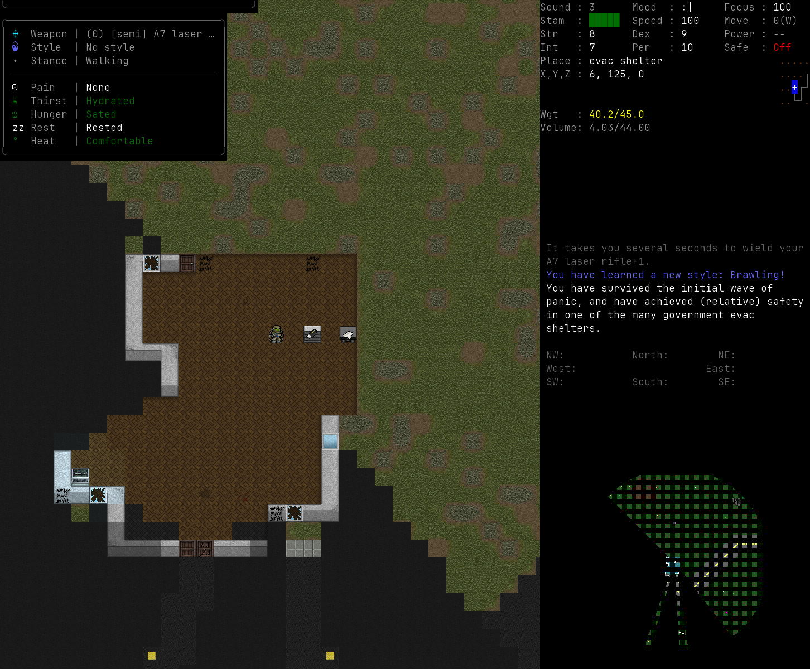
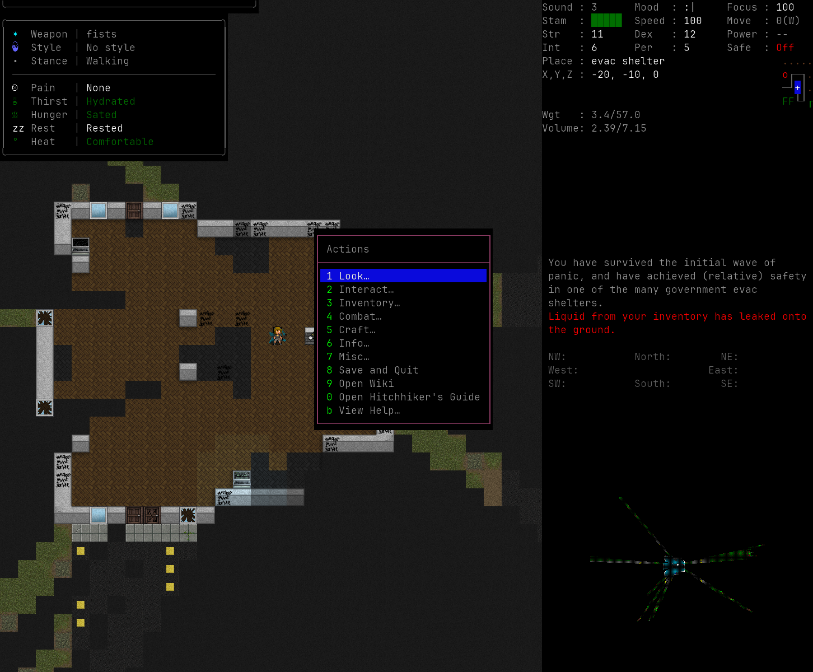
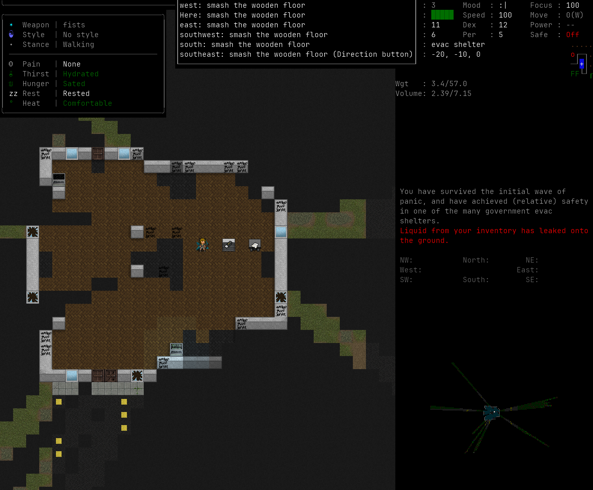
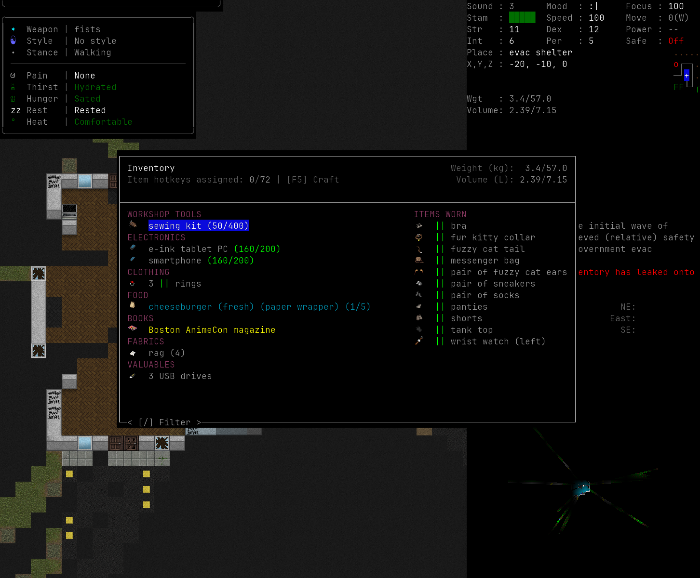
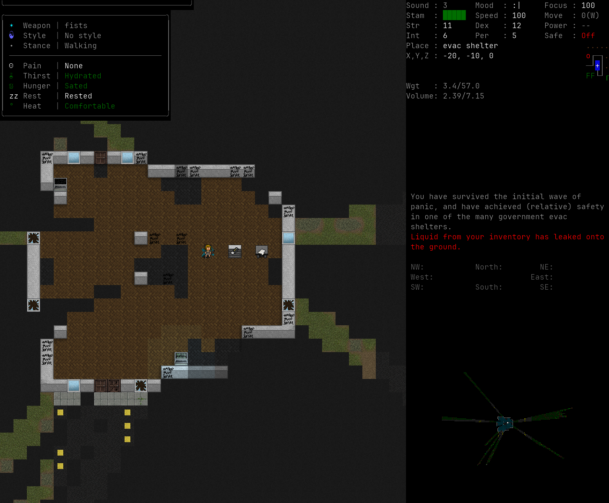
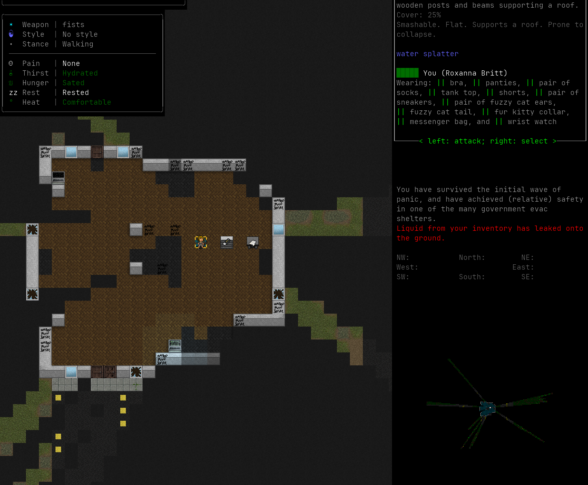
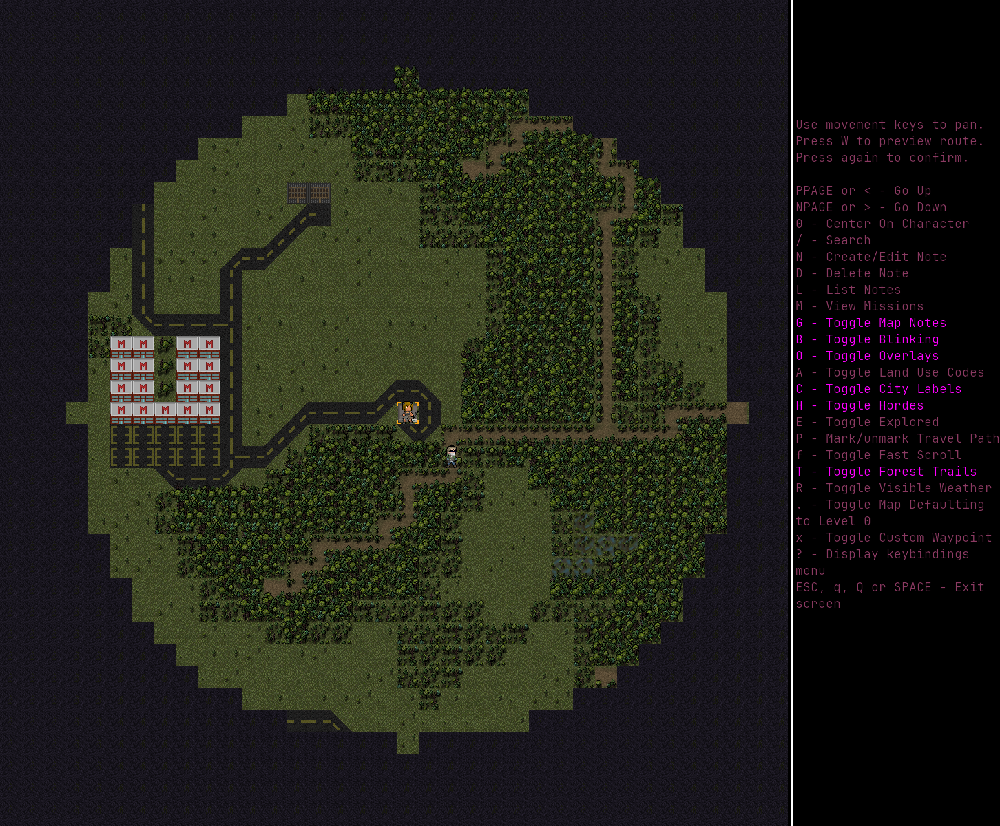
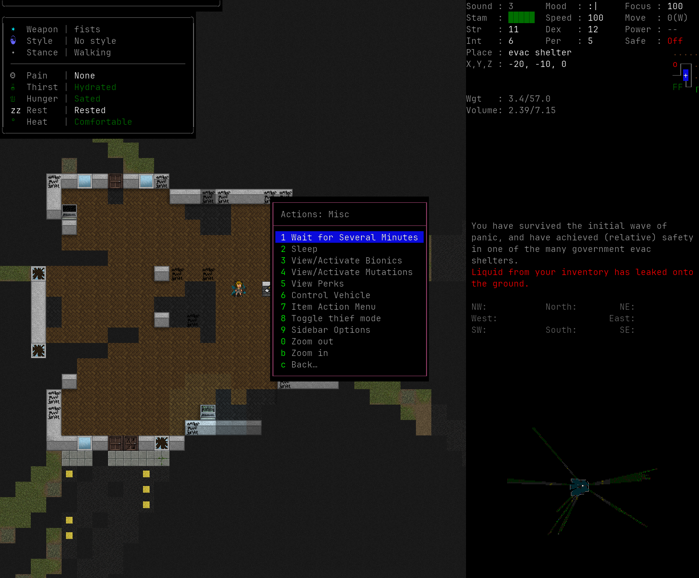

# Fork feature screenshots

One capture for each visible change this fork makes. Every image comes from the tiles build of the
current tree, started on a private display with a private user directory.

Regenerate them with:

```sh
python3 tests/e2e/feature_shots.py
```

## Modern HUD


The sidebar keeps every reading in one place: the body panel, the indicator boxes for needs, mood and sound, and the Controls strip that spells out movement, menus and the Look, target and stance keys. Modern binds `?` to the whole key list.

## Classic HUD



Classic keeps the upstream control scheme. The Controls strip follows the classic keys, so it shows `hjklyubn` movement instead of WASD, and the `?` key still lists everything.

## The Enter menu



Enter opens every command group: Items, Interact, Info, Misc, crafting, vehicles and settings. Modern routes each group here instead of binding a top-row number.

## Interact menu: quick stack and sort pile



Space opens Interact. Quick stack moves carried items into nearby storage that already holds them, and sort pile sorts the stack under the player without sorting zones.

## Inventory with item variants



One line holds one kind of thing. Rings, novels and other folded families list as a single entry with a count, and selecting a line opens the item's actions.

## Crafting with the parts chain



The crafting menu opens on a tab with recipes to make. The parts chain shows what a recipe needs, which of those parts the player can produce, and one honest time estimate.

## Look around and tile selection



Shift and a direction moves the cursor without spending a turn. The tile under the cursor shows what it holds, and Enter selects it for the next action.

## Map and minimap



The map opens on the local area with the pixel minimap the fork keeps on by default.

## Sidebar options from the Enter menu



Modern leaves the panel key unbound. Enter, then Misc, opens Sidebar Options, where the panels can be moved, hidden and reordered.

## Body panel and limb details


The body panel lists every limb with its own bar and names each wound. Enter, then Info, then Body status opens the same list with treatment hints.
