# Visual changes

Screens captured from the terminal build (132×42, Tokyo Night palette) by
`tests/e2e`'s tmux harness, so they show the real game, not mock-ups. These earlier captures predate
the grouped right sidebar and can show obsolete controls. Use `OVERHAUL.md` for current behavior
and `CHANGELOG-OVERHAUL.md` for changes by date.

## Title screen

The main-menu wordmark keeps the Bright Nights logo and adds a text-only **OVERHAUL** mark
beneath it. The title art fits an 80-column terminal and uses the same asset in curses and tiles.

## In game

New configurations use the **grouped** sidebar, based on the Opus HUD proposal. Its HUD readings
now float over the map as ten titled windows, and the remaining panels (Location, Controls, Map and
so on) stay on the right. The **labels** and **labels-narrow** layouts use the same windows. The
Classic and compact layouts keep their combined panels unchanged.

### Floating HUD windows

The slide-2 mockup's minimizable windows are the default HUD layout, and no keybinding was added
for them.

- The **Weather**, **Combat**, **Needs**, **Limbs**, **Stats**, **Movement**, **Weight**,
  **Compass**, **Log** and **Vehicle** windows each have a title row with the window name, one line
  of live state and `[-]` at the right. Clicking `[-]` collapses the window to that row — the
  control becomes `[+]` and the live state stays, so the readings are hidden, not lost. Clicking
  the window name (or `[+]`) restores it.
- Click a title to pick the window up, move the pointer, then click again to put it down. The
  rest of a collapsed window's title row is still a drag handle, so it can be moved without
  expanding. The window stays inside the map area and never covers the sidebar column.
- Left and right clicks on a window never reach the map, so a stray click cannot walk, aim or
  open a tile action under the window.
- Position, collapsed state and visibility are saved per character.
- **Enter → Misc → Sidebar Options** lists the windows in the third column, below the layouts.
  Move there with the arrow keys and press Tab to enable or disable the selected window; a mouse is
  never required. Disabling a window puts its readings back in the sidebar. A window that cannot
  fit the map — a small terminal with several windows open — also hands its reading back instead
  of overlapping another.
- The readings mirror the sidebar panels: **Limbs** gives each limb's health bar and worst wound;
  **Stats** gives Str, Dex, Int, Per in the panel's boosted/reduced colours, bionic power and the
  safe-mode readout; **Movement** gives speed, move cost, sound, stamina, mood and focus; **Weight**
  gives carried weight and volume; **Compass** gives each direction's seen symbols, counts and
  threat colour; **Log** gives the recent coloured message lines at the window's width; **Vehicle**
  gives speed, azimuth, engine, fuel and battery. The **Needs** window lists only needs that call
  for attention, with a glyph and label instead of an adjective, or a **Needs met** row. The
  **Vehicle** window exists only while aboard or remote-controlling a vehicle.
- Both the terminal and tiles builds draw the same windows. Where a build has no mouse, only the
  Sidebar Options path applies.
- **Options → Interface → Floating HUD windows** is on by default for the modern layouts. Turning
  it off keeps the old fixed corner boxes; the weather, status and vehicle box corner options still
  seed each window's first position and visibility. **Compact corner bars** also keeps the old
  layout, and Classic and compact layouts always keep their combined panels.
- **Driving dashboard** is a separate, off-by-default option. It expands Fusion's Vehicle card
  and the legacy floating Vehicle window without changing that window's identity, placement,
  collapse or save state. With the option off, the compact reading remains.
- Clicking or dragging a window brings it to the front, and **Enter** on its row in Sidebar
  Options does the same from the keyboard. The stacking order saves per character with the
  positions. A dragged window keeps its top-left through a collapse; an untouched default window
  stays bottom-anchored in its corner.

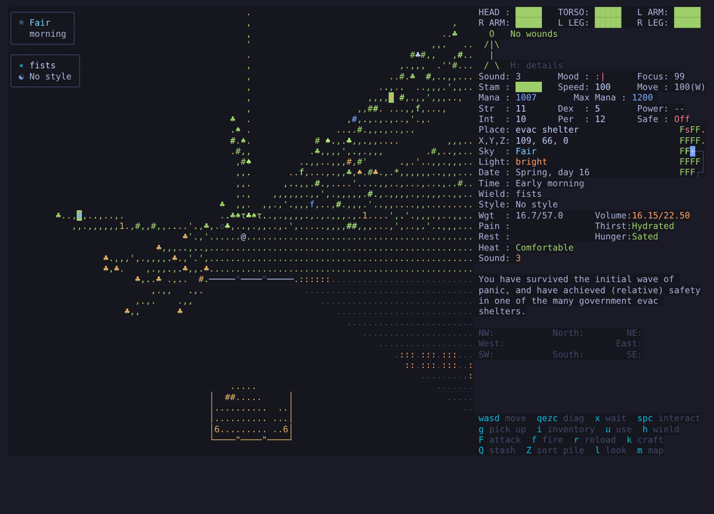


- Top left: the **weather box** (icon, weather, time) and the **Status box** (weapon, style, stance
  and needs; this capture shows its earlier weapon-only form).
- Sidebar: the **body panel** (a figure coloured by limb health, wounds beside it) and the
  **Controls strip** (the capture predates compact action families; current hints use live bindings).
- Map: **readable glyphs**. Trees are ♣, pines ♠ and saplings τ instead of 7, 4 and 1.
- Rounded window corners.
- **Compact corner bars** (Options → Interface) replaces the two boxes with one-row strips:
  `Weather: Drizzle  │  Spring 16 morning  │  Light: bright  │  Wind: Calm Air NE`. The status
  strip carries the weapon, style and stance. The sidebar keeps its panels either way.

For comparison, the same kind of start with the classic control scheme, classic colours, digit
glyphs and the map boxes turned off. The fork's sidebar panels stay; each can be hidden from the
sidebar options.

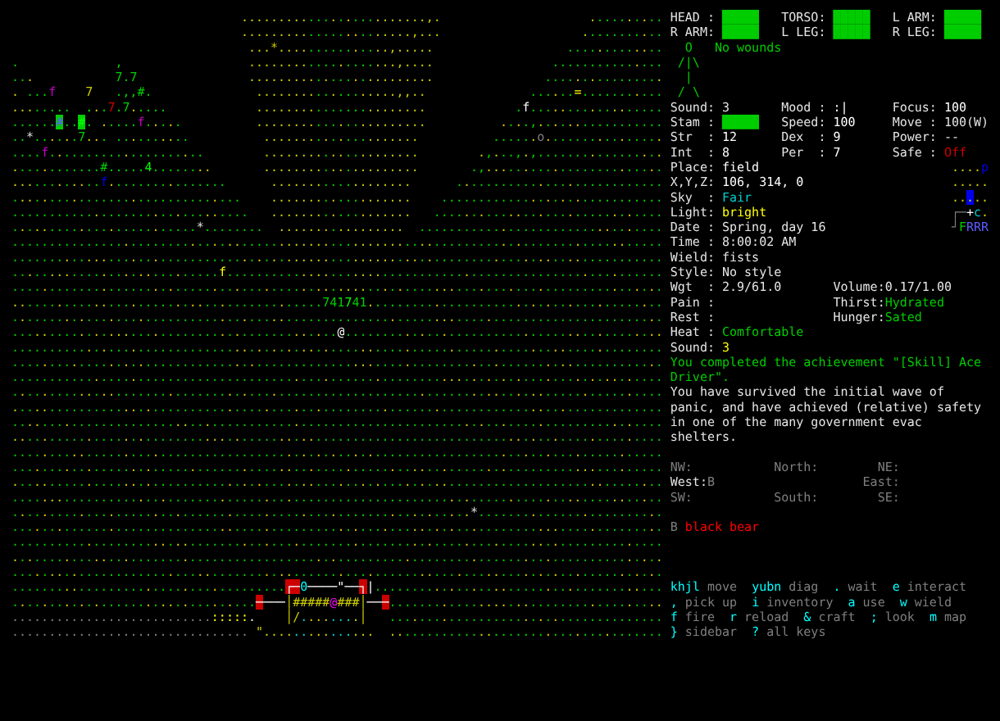

## Driving dashboard

**Driving dashboard** (`DRIVING_DASHBOARD`, Options → Interface) is opt-in and off by default in
terminal and tiles builds. It expands Fusion's existing 32-column Vehicle card and the floating
Vehicle window in legacy labels/grouped layouts. Off keeps the compact reading; Classic and
compact layouts keep their old panels either way. It uses Fusion's existing glyph/text vocabulary,
not a separate art style.

**Compact reading — option off**

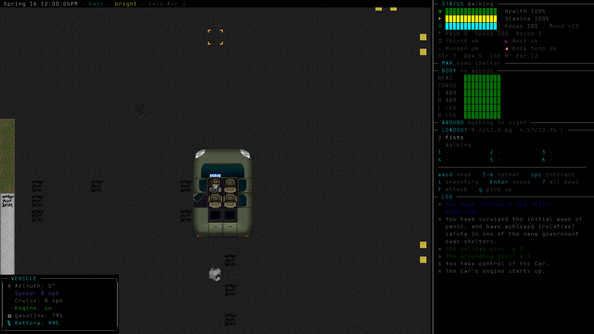

**Expanded instruments — option on**


Both captures use the same saved car and driving inputs. Exhaust and the weather ribbon can
differ between runs; the dashboard option does not change the saved driving state.

- The title row carries speed, unit and compass letter; body rows carry the speed bar,
  azimuth, cruise state and target, engine state, fuel, battery and aircraft takeoff state.
- Fusion uses its existing 32-column lower-left card at 140×36 or larger. At 80×25, selecting
  Fusion falls back to grouped. The legacy floating window keeps its placement, collapse and
  visibility controls; check that the fallback leaves the avatar and vital readings visible.
  The heading, fuel and battery rows use existing HUD glyphs; **Text only** leaves the labels
  without an icon column.
- Palette: the speed row uses the compact readout's strain colours, the engine row uses green,
  yellow and red for strain, fuel is grey/yellow/red, battery is cyan/yellow/red, cruise-on is
  green, `lift` is green and `no lift` is red, and remote control is cyan.
- Every colour has a text or shape cue: `On`/`Off`, `low`/`low!`/`empty`, `!`/`!!`/`!!!` strain marks, a
  bar of `#` and `-`, `lift`/`no lift`, and a signed speed for reverse. A monochrome terminal keeps
  all of the information. The speed bar fills toward the safe speed; above it the row first turns
  yellow and gains a marker.
- `Remote control` appears only while a remote vehicle is under control. The aircraft row keeps
  the takeoff speed in the configured unit and reports whether the current speed reaches it; a wing
  that cannot lift reports `no lift`.
- No new images, sprites or glyph art are added: the icons come from the fork's existing HUD set.
  There is no copied Zomboid asset and no generated artwork. Project Zomboid is a layout
  reference only.

The option changes presentation only, not driving controls, selected speed units or action time
costs. Remote-control status and aircraft takeoff/lift information remain available.

Reproduce the native comparisons, including the 80×25 fallback and 1×/2× scaling:

```sh
python3 tests/e2e/tiles.py driving_dashboard --out /tmp/bn-driving-dashboard-proof
```

The case retains captures, input traces and saved driving states. The terminal scenarios also
exercise remote control, aircraft takeoff/lift, warning thresholds and the off/legacy paths:

```sh
python3 tests/e2e/run.py --serial dashboard
```

## Mouse tile selection

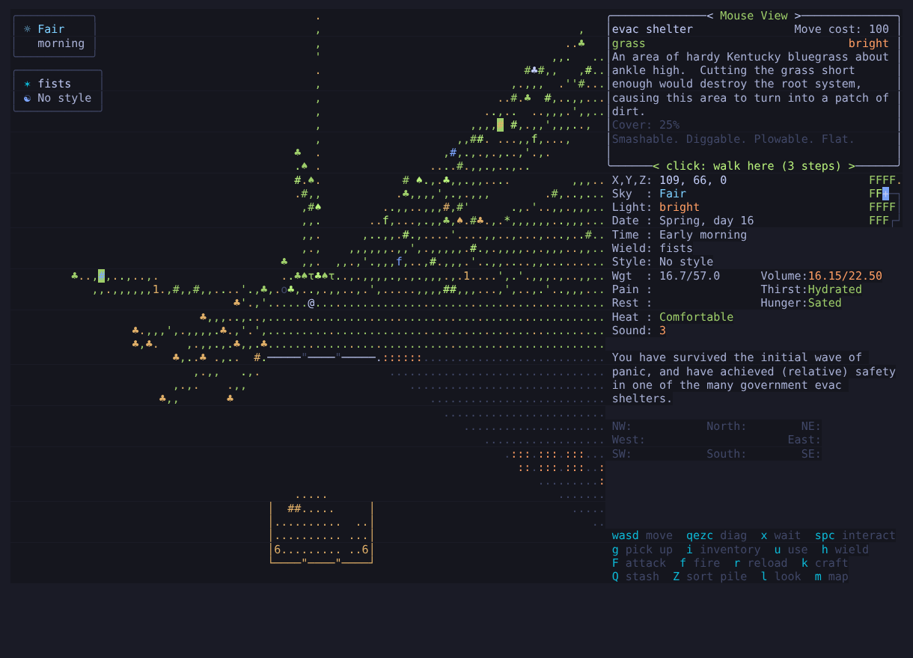

Modern uses keyboard-only movement. Hovering inspects a tile; right click selects it freely,
and left click uses an adjacent door, item or furniture, or attacks the clicked hostile.
Space offers actions for the selected tile, including explicit Jump and Smash choices.
With nothing selected, Space lists nearby actions and highlights their tiles. Classic retains upstream mouse movement.

Tile hit-testing follows the display scaling factor and the sidebar position, so moving the
sidebar left or choosing 2x scaling does not shift the tile under the pointer. Menu clicks use
the text grid, even when the terrain tileset is isometric.

## Body panel and details

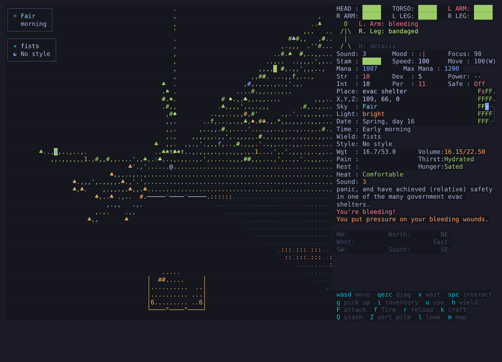

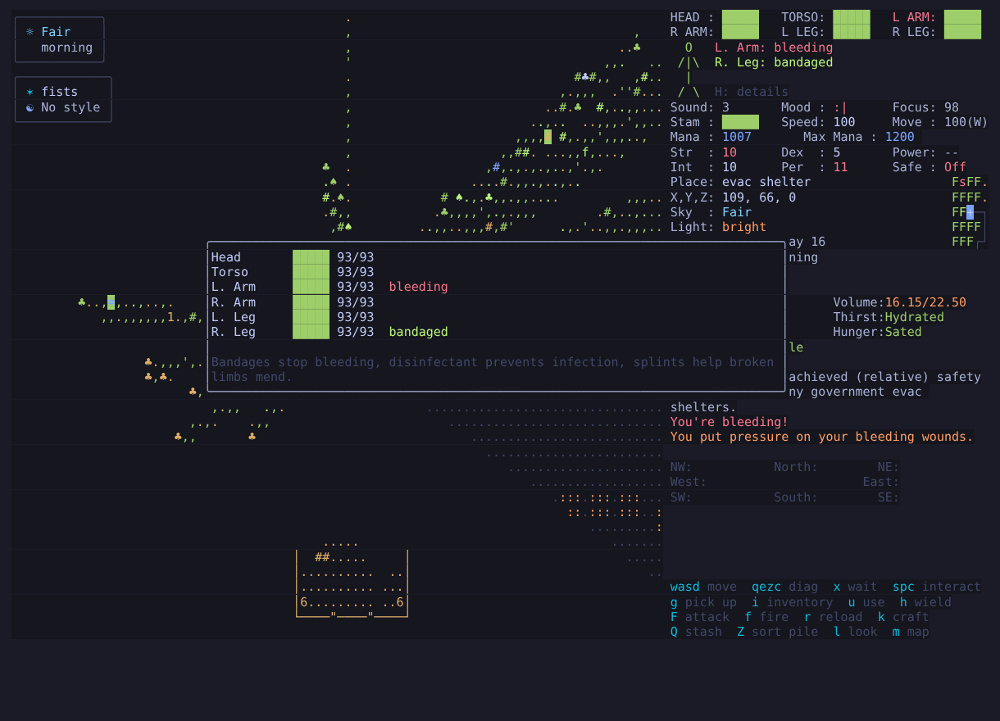

## First game

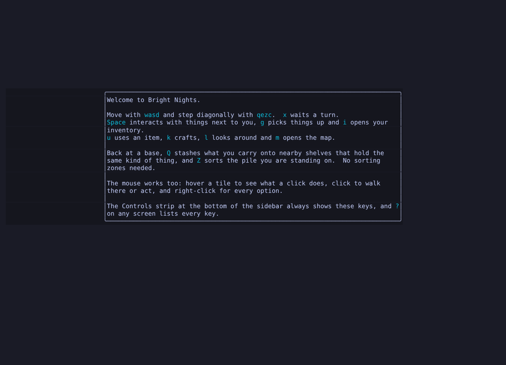

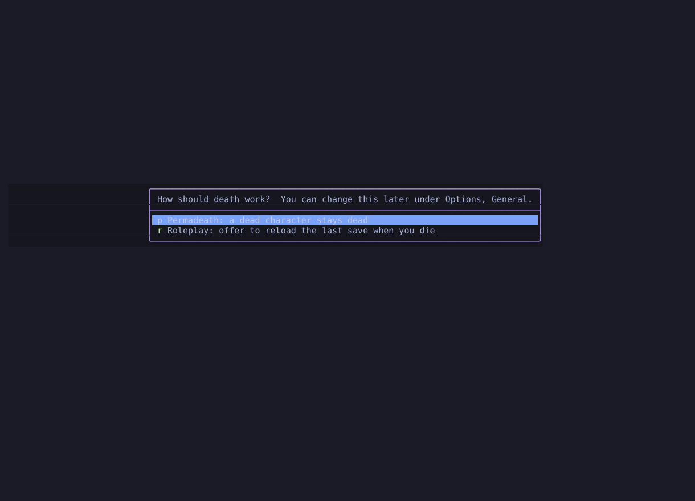

The welcome card lists the core keys with their live bindings, then asks how death works, like
Caves of Qud's Classic and Roleplay modes.

## Prompts and menus

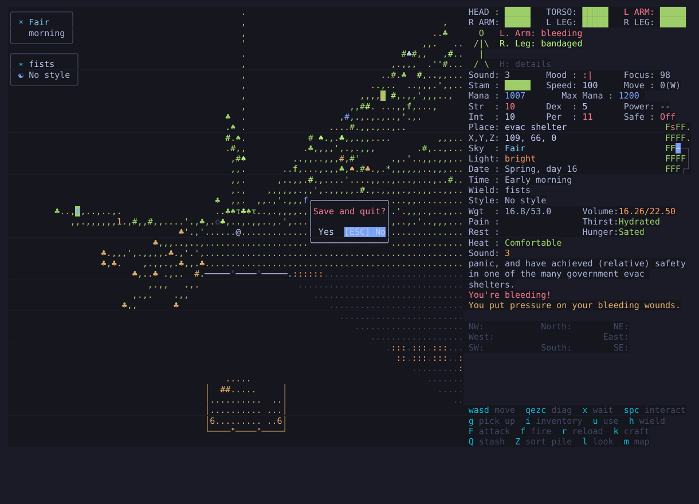

Yes/No prompts are buttons that open on **No**; Enter or a click answers and Esc cancels.

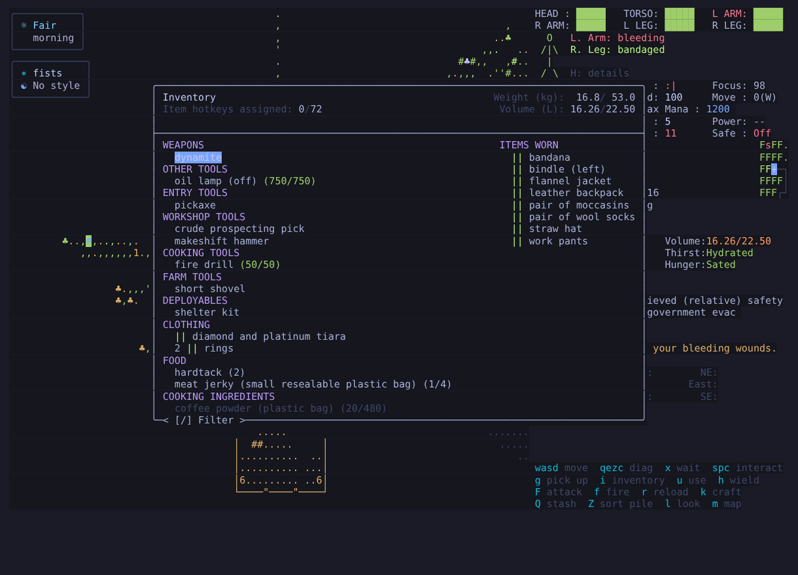

Jewelry is one item per form. Different rings stack on one line, and each keeps its own gem,
metal, name and price.

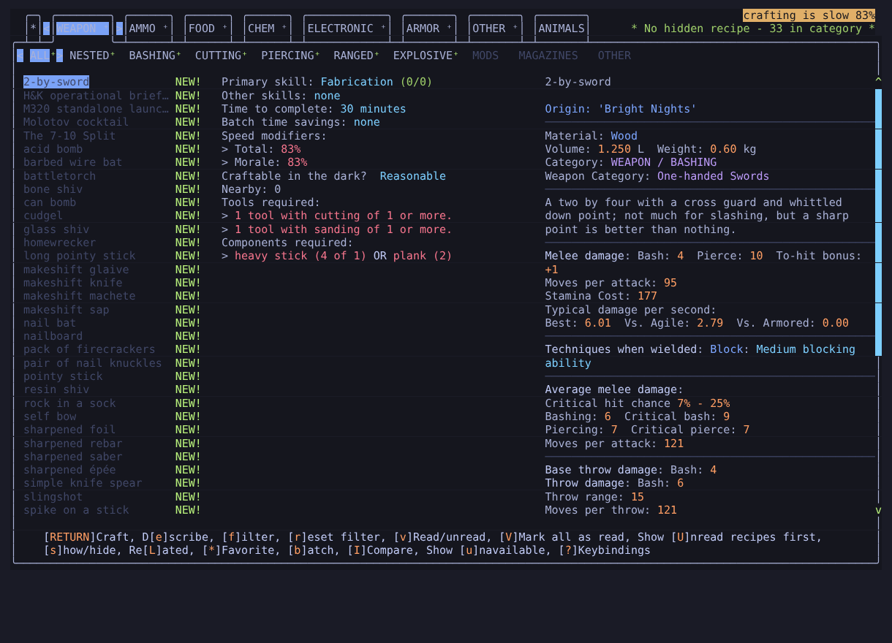

Open crafting with **`i`, then F5 Craft**, including with an empty inventory. The crafting menu
opens on a tab that has recipes instead of an empty one.
