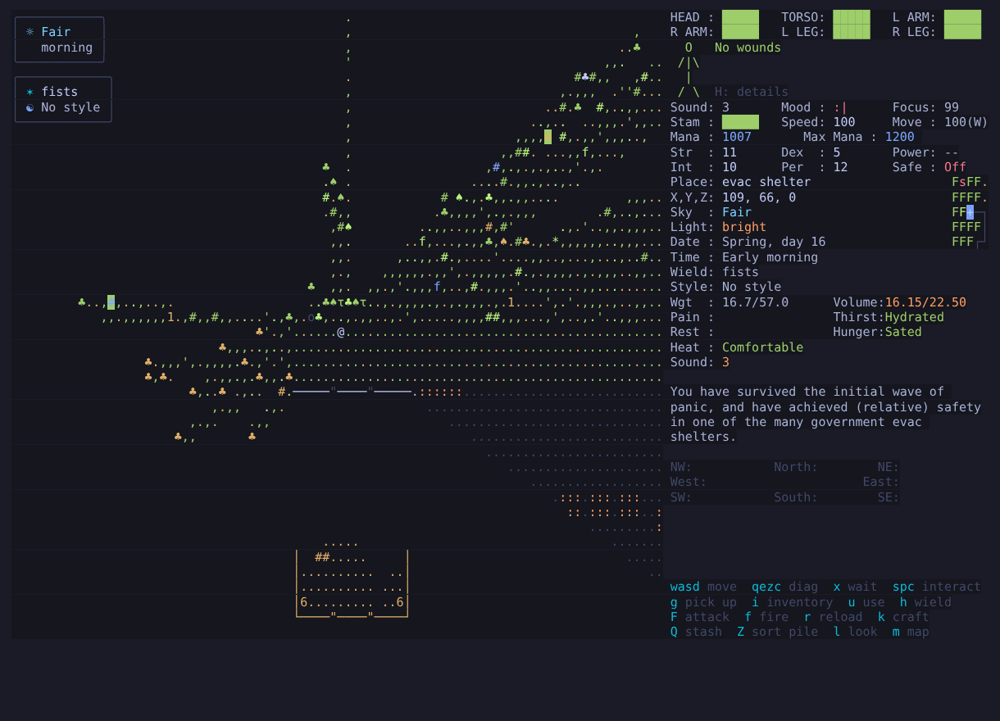
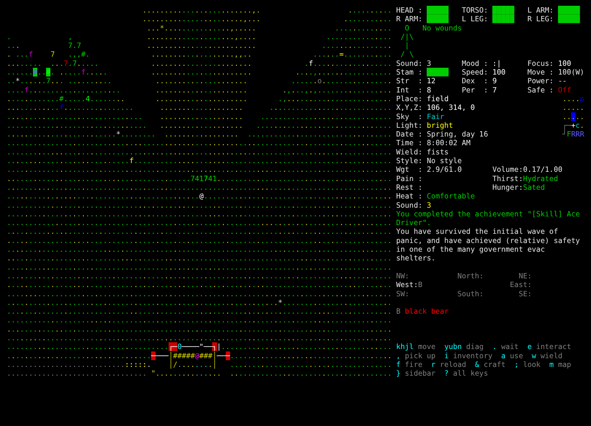
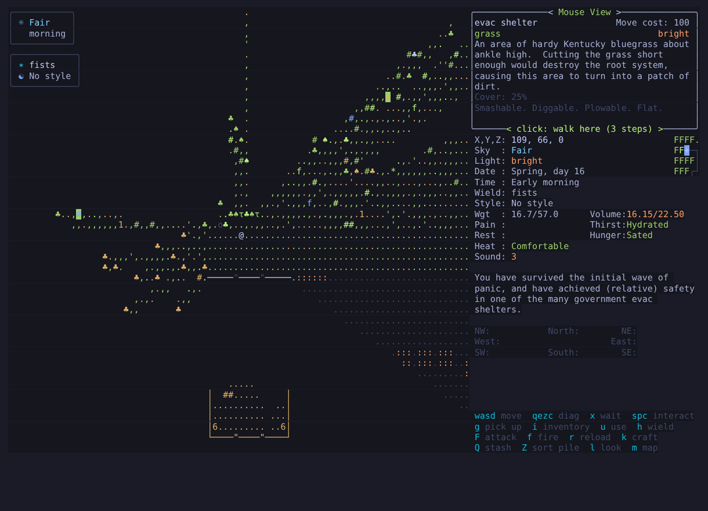
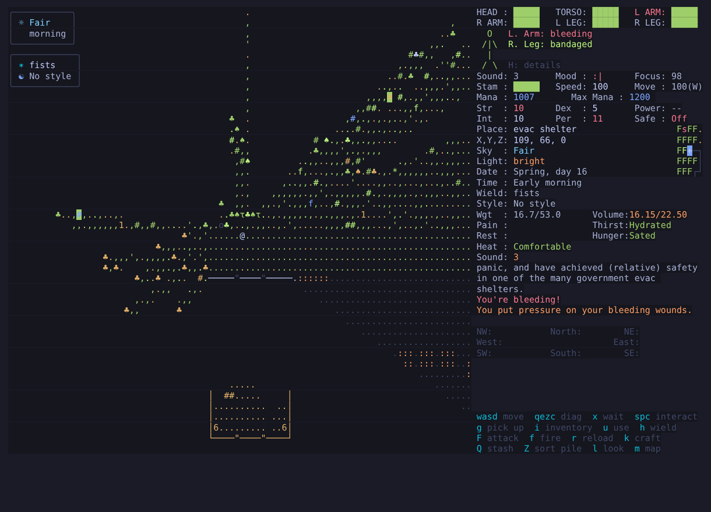
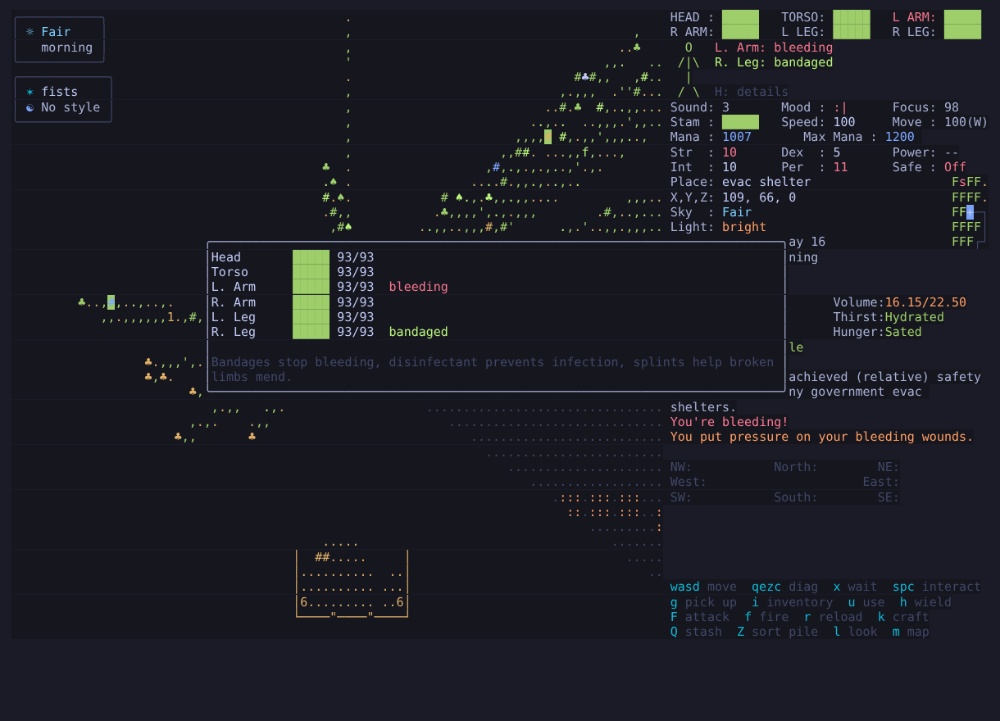
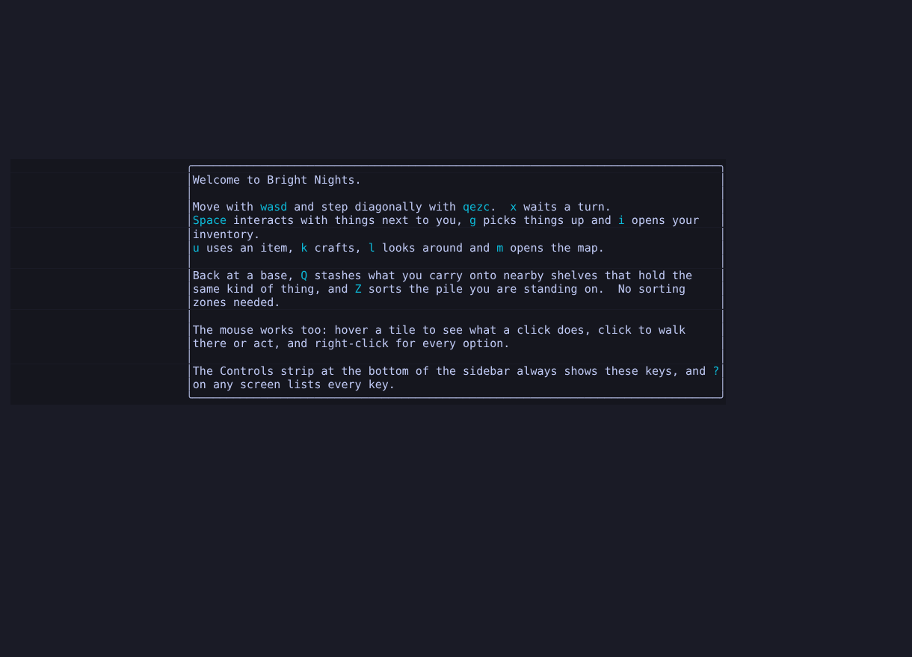
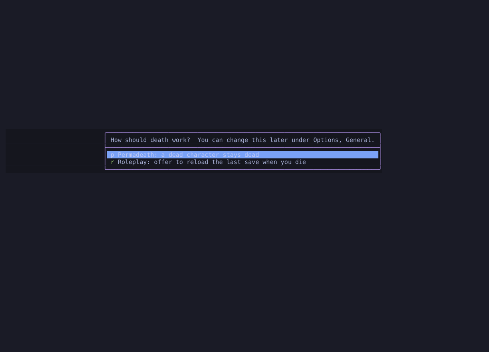
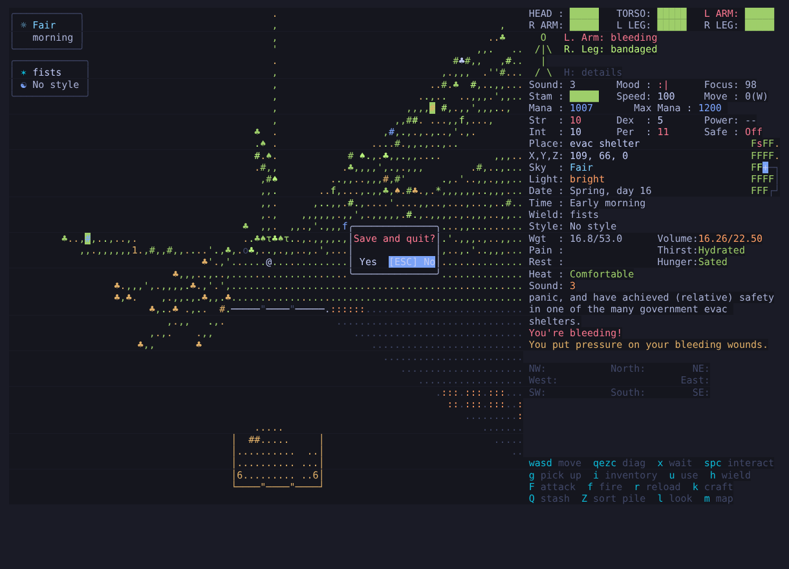
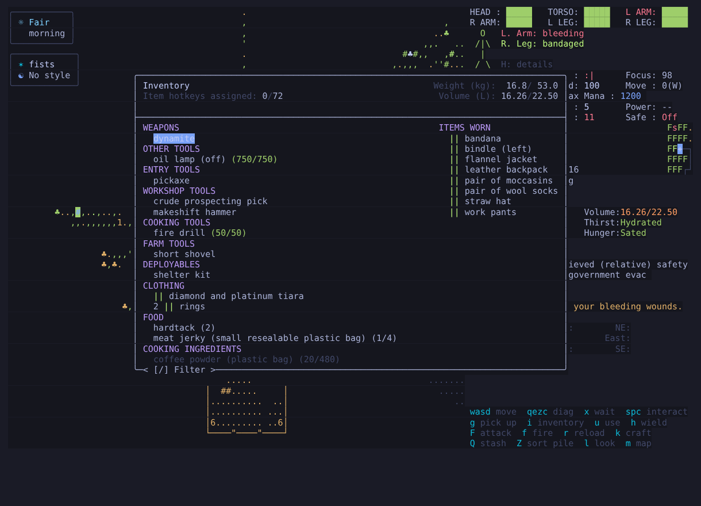
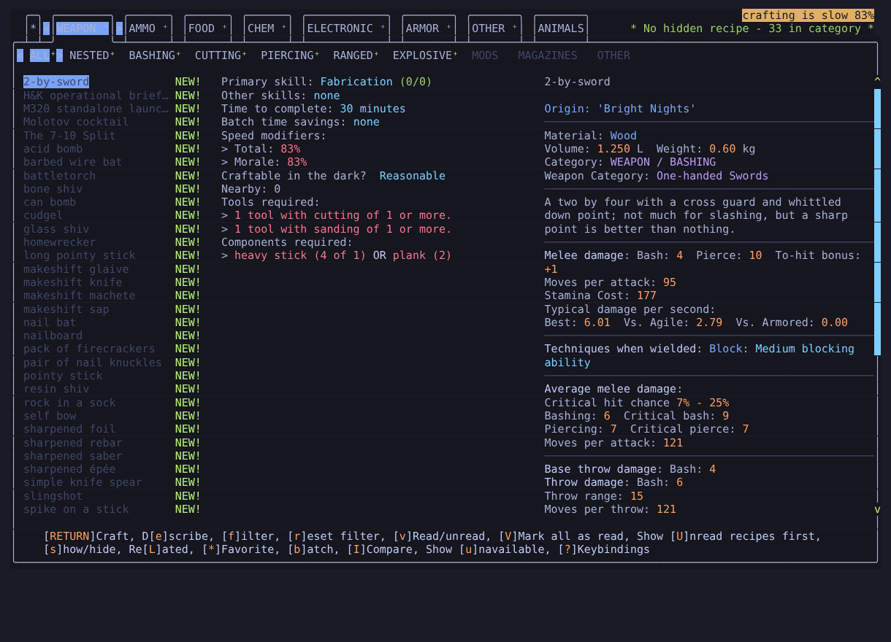

# Visual changes

Screens captured from the terminal build (132×42, Tokyo Night palette) by
`tests/e2e`'s tmux harness, so they show the real game, not mock-ups. These earlier captures can
show obsolete control labels; use `OVERHAUL.md` for current keys and
`CHANGELOG-OVERHAUL.md` for changes by date.

## In game

- Top left: the **weather box** (icon, weather, time) and the **weapon box** (weapon, fighting style).
- Sidebar: the **body panel** (a figure coloured by limb health, wounds beside it) and the
  **Controls strip** (the capture predates compact action families; current hints use live bindings).
- Map: **readable glyphs**. Trees are ♣, pines ♠ and saplings τ instead of 7, 4 and 1.
- Rounded window corners.

For comparison, the same kind of start with the classic control scheme, classic colours, digit
glyphs and the map boxes turned off. The fork's sidebar panels stay; each can be hidden from the
sidebar options.

## Mouse tile selection

Modern uses keyboard-only movement. Hovering inspects a tile; right click selects it freely,
and left click attacks the clicked hostile. Space offers actions for the selected tile, including
explicit Jump and Smash choices. The capture above predates this behavior: Modern clicks no
longer walk. Classic retains upstream mouse movement.

Tile hit-testing follows the display scaling factor and the sidebar position, so moving the
sidebar left or choosing 2x scaling does not shift the tile under the pointer. Menu clicks use
the text grid, even when the terrain tileset is isometric.

## Body panel and details

## First game

The welcome card lists the core keys with their live bindings, then asks how death works, like
Caves of Qud's Classic and Roleplay modes.

## Prompts and menus

Yes/No prompts are buttons that open on **No**; Enter or a click answers and Esc cancels.

Jewelry is one item per form. Different rings stack on one line, and each keeps its own gem,
metal, name and price.

Open crafting with **`i`, then F5 Craft**, including with an empty inventory. The crafting menu
opens on a tab that has recipes instead of an empty one.
